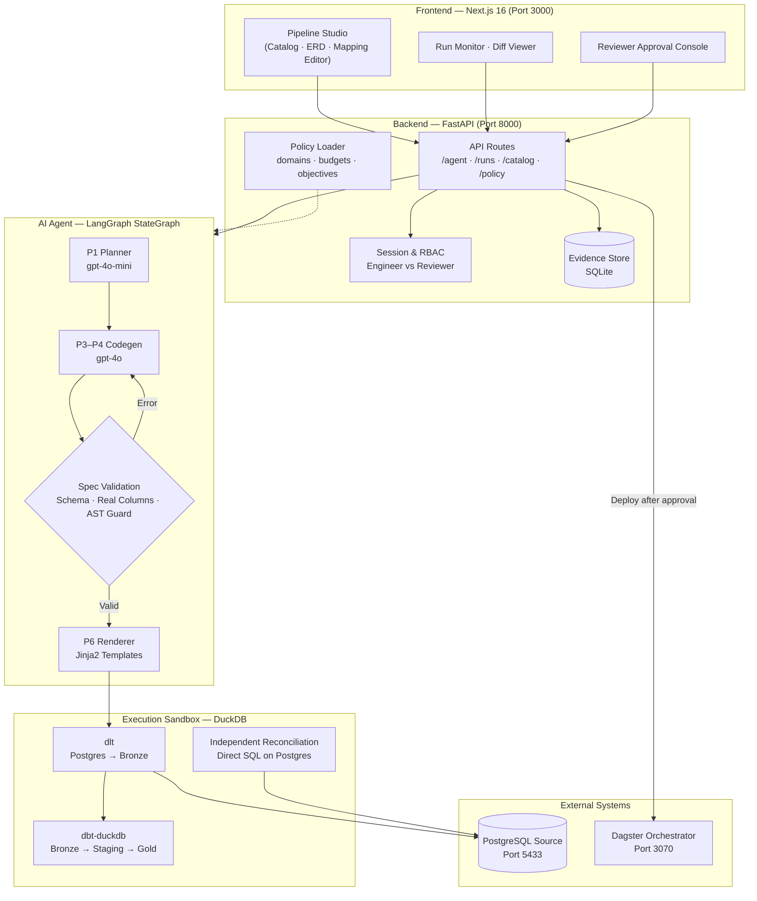
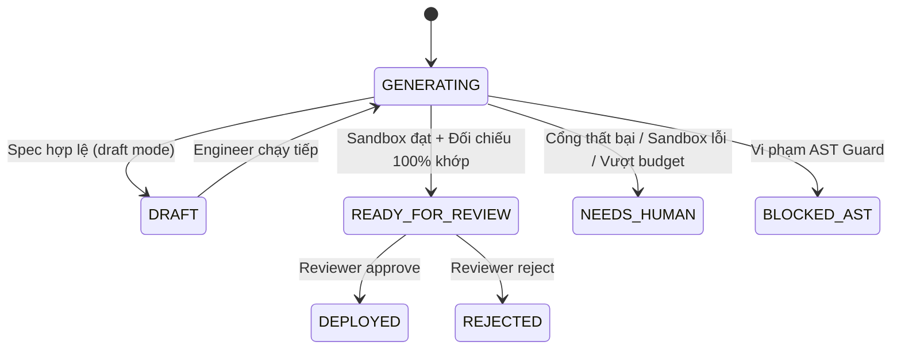
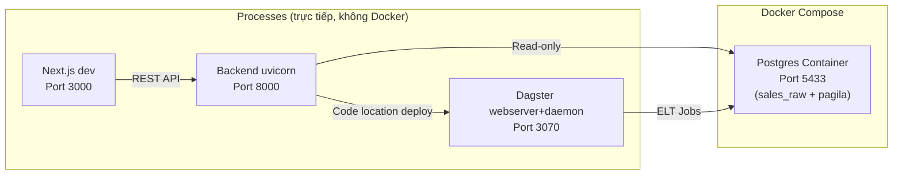

# Architecture Document — Atomesus (P-045)

## System Overview

**Atomesus** là nền tảng AI-Native ELT Pipeline Platform: kỹ sư dữ liệu mô tả nhu cầu bằng ngôn ngữ tự nhiên, AI Agent phân tích schema thật và sinh Spec kỹ thuật, mã nguồn pipeline (dlt → dbt → Dagster) được tạo tất định từ Jinja2 template, chạy thử trong sandbox cô lập, đối chiếu độc lập với nguồn Postgres, và **bắt buộc có người duyệt** trước khi triển khai chạy định kỳ.

Chi tiết đầy đủ: [`docs/system_architecture_analysis.md`](docs/system_architecture_analysis.md)

## Architecture Diagram

## Components

### 1. Frontend (Next.js 16)
- **Purpose:** Giao diện duy nhất cho cả Engineer và Reviewer; không có logic nghiệp vụ trong client.
- **Key Features:**
  - Catalog dữ liệu: tìm kiếm theo tên cột, xem lineage, chất lượng, lịch chạy Dagster
  - Sơ đồ ER tương tác (kéo thả, zoom) cho từng nguồn Postgres
  - Mapping Editor: Engineer xem và điều chỉnh cấu hình ép kiểu / lọc trước khi chạy thử
  - Run Monitor: cập nhật tiến độ theo poll, xem diff file sinh ra (Monaco Editor)
  - Reviewer Console: xem bảng kết quả thật, bằng chứng đối chiếu, và ký duyệt
- **State Management:** Server state (fetch/poll FastAPI), không dùng Redux

### 2. Backend (FastAPI)
- **Purpose:** API server duy nhất điều phối toàn bộ nghiệp vụ — xác thực, phân quyền, chạy Agent, lưu bằng chứng, và deploy.
- **API Design:** RESTful, prefix `/api/v1`
- **Sub-routers:**
  - `/agent` — tạo run, tạo draft, tiếp tục draft
  - `/runs` — lịch sử, chi tiết, approve, reject, compare
  - `/catalog` — kết nối nguồn, đọc schema, sơ đồ ER
  - `/pipeline` — session/auth demo, run làm sạch (legacy Sprint 1-B)
  - `/policy` — đọc domains.yml, budgets.yml, objectives.yml
  - `/chat` — trò chuyện về run hiện có
  - `/orchestration` — giao tiếp với Dagster GraphQL
- **Authentication:** Cookie HttpOnly, session lưu SQLite, giới hạn 8 giờ; tắt tính năng demo khi `APP_ENV=production`

### 3. AI Agent (LangGraph StateGraph)
- **Agent Type:** Custom Plan-and-Generate (không phải ReAct)
- **State Schema:** `AgentState` (TypedDict) gồm `run_id`, `status`, `plan`, `spec`, `gates`, `checks`, `files`, `files_hash`, `llm_calls`, `timeline`, `error_trace`
- **Nodes:**
  | Node | Phase | Loại | Nhiệm vụ |
  |------|-------|------|----------|
  | `planner` | P1 | LLM rẻ | Đọc metadata → Sinh kế hoạch JSON |
  | `codegen` | P3–P4 | LLM mạnh | Đọc schema thật + 20 dòng mẫu → Sinh Spec |
  | `render` | P6 | Tất định | Spec → 4+N file qua Jinja2 |
  | `test_run` | P9–P12 | Tất định | Chạy dlt+dbt sandbox, đối chiếu độc lập |
- **Guardrails (3 cổng):**
  1. `spec_schema` — Pydantic validation + kiểm tra policy
  2. `schema_real` — Đối chiếu cột với DB nguồn thật
  3. `ast_guard` — Chặn biểu thức nguy hiểm (DROP, INSERT, `{}`, `;`...)
- **Budget:** tối đa 2 lần sửa Spec, 6 lần gọi LLM mỗi run

### 4. Sandbox & Independent Reconciliation
- **Sandbox:** Thư mục tạm + `warehouse.duckdb` riêng mỗi run; subprocess dlt/dbt không nhận API key LLM
- **Pipeline path:** `Postgres nguồn → dlt (Bronze) → dbt Staging (TRY_CAST, khử trùng) → dbt Gold`
- **Reference path:** Spec được dịch thành **1 câu SQL Postgres** bằng `reference.py`, chạy bằng tài khoản read-only, so khớp từng dòng với Gold DuckDB
- **Kết quả:** `READY_FOR_REVIEW` (khớp 100%) hoặc `NEEDS_HUMAN` (kèm chẩn đoán lỗi tự động)

### 5. Evidence Store (SQLite)
- **Path:** `data/pipeline/runs.sqlite3`
- **Dữ liệu:** `RunReport` (trạng thái, Spec, kế hoạch, bằng chứng), nội dung file sinh ra, `files_hash`, lịch sử phiên bản, chat messages, sessions
- **Không dùng ORM**: SQLite thuần qua `sqlite3` module để giữ đơn giản và dễ kiểm tra

### 6. Orchestration (Dagster)
- **Port:** 3070 (webserver + daemon)
- **Assets:** `@dlt_assets`, `@dbt_assets` sinh tự động từ template `dagster_asset.py.j2`
- **Deploy:** Sau khi Reviewer duyệt, `deploy.py` ghi file asset vào thư mục code location; Dagster tự nạp và kích hoạt lịch chạy

## Data Flow

1. Engineer nhập yêu cầu bằng lời + chọn bảng nguồn → `POST /api/v1/agent/drafts`
2. Planner đọc schema metadata thật → sinh kế hoạch JSON (P1)
3. Codegen đọc schema chi tiết + 20 dòng mẫu thật → sinh Spec → kiểm 3 cổng (P3–P4)
4. Nếu lỗi cổng: phản hồi lỗi cụ thể cho Codegen, lặp tối đa 2 lần
5. Khi Spec hợp lệ → trạng thái `DRAFT`; Engineer xem và chỉnh sửa Mapping trên UI
6. Engineer bấm "Chạy thử" → `POST /api/v1/agent/runs/{id}/continue`
7. Render sinh 4+N file từ template Jinja2 (P6)
8. Sandbox: dlt tải dữ liệu thật → dbt build → dbt test (P9–P12)
9. Reconcile: chạy SQL đối chiếu độc lập trên Postgres → so khớp từng dòng
10. Lưu `RunReport` với đầy đủ bằng chứng vào SQLite → trạng thái `READY_FOR_REVIEW`
11. Reviewer xem diff, bảng kết quả và bằng chứng → ký duyệt kèm `files_hash`
12. Backend deploy file vào Dagster → trạng thái `DEPLOYED` → pipeline chạy định kỳ

## Run Status State Machine

## Deployment Architecture

> **Môi trường sản xuất:** Dockerfile multi-stage có sẵn cho backend; frontend build tĩnh qua `npm run build`. CI (GitHub Actions) chạy `ruff + pytest` khi push lên `main`/`develop`.

## Security

- API keys lưu trong `.env` (không commit git)
- Input validation qua Pydantic (tất cả request body)
- RBAC: Engineer tạo run, Reviewer duyệt — không tự duyệt bài của mình
- Cookie session HttpOnly, SameSite strict, TTL 8 giờ
- Subprocess sandbox không nhận biến môi trường nhạy cảm (LLM key, v.v.)
- Tài khoản Postgres `pipeline_reader` chỉ có quyền SELECT
- `files_hash` mật mã ngăn chặn thay đổi mã nguồn sau khi Reviewer xem

## Design Decisions

| Quyết định | Lựa chọn | Lý do |
|---|---|---|
| Backend framework | FastAPI | Async, auto-docs Swagger, type-safe với Pydantic |
| AI Agent framework | LangGraph | StateGraph linh hoạt, debug được từng node, hỗ trợ vòng lặp có kiểm soát |
| Template engine | Jinja2 (delimiter `[[ ]]`) | Tất định, kiểm thử được; tách biệt khỏi cú pháp `{{ }}` của dbt |
| Execution DB | DuckDB | In-process, không cần server, đọc Postgres qua dlt + SQLAlchemy |
| Evidence Store | SQLite | Đơn giản, không cần server, dễ backup, đủ cho quy mô demo |
| Frontend | Next.js 16 + React 19 | App Router, Server Components, Monaco Editor tích hợp sẵn |
| Orchestrator | Dagster | Asset-based lineage, DbtAssets + DltAssets tích hợp tốt, UI ổn định |
| Auth | Cookie HttpOnly | Không cần JWT library; phù hợp với web-only client |
