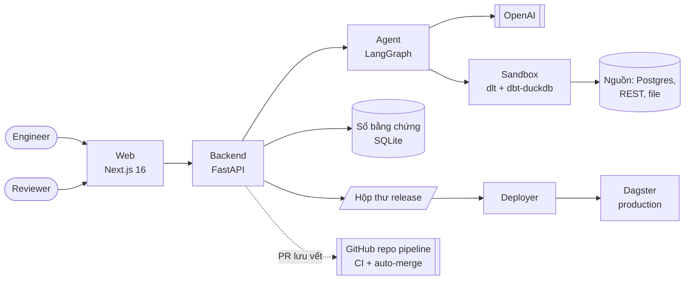
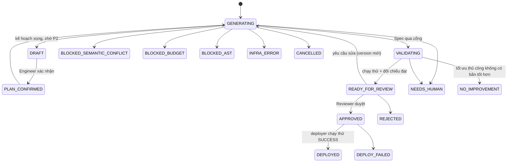
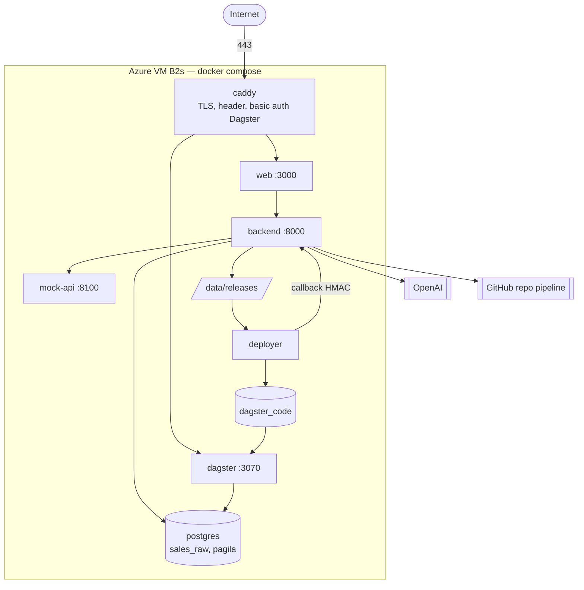

# Architecture Document — Atomesus (P-045)

> Cập nhật 2026-10-18 theo code trên `main`. Sơ đồ chi tiết (ngữ cảnh, thành phần, production, agent, luồng
> end-to-end, máy trạng thái, deploy, bảo mật): [docs/architecture_diagram.md](docs/architecture_diagram.md).
> Quyết định thay đổi so với SPEC: [docs/adr/0001-mot-luong-va-nen-production.md](docs/adr/0001-mot-luong-va-nen-production.md).

## System Overview

**Atomesus** là control plane sinh pipeline ELT bằng AI: Engineer mô tả nhu cầu dữ liệu bằng ngôn ngữ tự nhiên, agent
đọc schema thật và viết **Spec** (JSON có kiểu, qua 11 cổng kiểm); code pipeline (dlt → dbt → Dagster) được **sinh tất
định** từ template Jinja; chạy thử trên dữ liệu thật trong sandbox DuckDB riêng mỗi run và **đối chiếu độc lập** với
nguồn; optimizer đo và chỉ giữ bản vừa đúng vừa nhanh hơn; **Reviewer (khác Engineer)** duyệt bộ file có hash rồi
Deploy; deployer kiểm chữ ký, cài vào Dagster production, chạy thử một lần rồi mới báo `DEPLOYED`.

- Live: https://c4-app-045.id.vn (Dagster: https://dagster.c4-app-045.id.vn, có mật khẩu)
- Hạ tầng: 1 VM Azure B2s, Docker Compose (`deploy/compose.yml`), Caddy HTTPS

## Components

### 1. Frontend (Next.js 16, React 19 — `web/`)

- **Vai trò:** giao diện duy nhất cho Engineer, Reviewer, Admin. Server Components gọi backend qua `PIPELINE_BACKEND_URL`;
  trình duyệt gọi `/api/v1/*` được Next rewrite sang backend nên chỉ một tên miền.
- **Trang:**
  | Trang | Cho ai | Nội dung |
  |---|---|---|
  | `/` | công khai | Landing page |
  | `/explore`, `/datasets/[id]`, `/domains`, `/relationships`, `/glossary` | mọi vai | Data Catalog: tìm theo cột, lineage, chất lượng, sơ đồ quan hệ, thuật ngữ |
  | `/runs/new` | Engineer | Yêu cầu pipeline (một hoặc nhiều cùng lúc), chọn nguồn và bảng |
  | `/runs`, `/runs/[id]` | theo quyền xem | Kế hoạch (xác nhận P2), mapping, diff file (Monaco), bằng chứng, staging, chat, tóm tắt màn duyệt, khung Triển khai |
  | `/runs/review` | Reviewer | Duyệt nhiều run cùng lúc |
  | `/monitor` | mọi vai | Pipeline đã deploy: thời gian, chi phí, test dbt, cảnh báo chậm / nguồn ngừng cấp |
  | `/results/[model]` | theo quyền | Bảng gold phân trang, tải CSV/XLSX |
  | `/connections` | Engineer | Kết nối Postgres của người dùng, tải file CSV/XLSX, chọn bảng |
  | `/reviewers`, `/invite/[token]` | Engineer / người được mời | Mời Reviewer bằng link |
  | `/policy` | mọi vai | Admin xem file YAML; vai khác thấy "Giới hạn của bạn" bằng câu thường |
  | `/admin/users` | Admin | Quản lý tài khoản, cấp quyền Reviewer |
- **State:** dữ liệu server (fetch + poll), không Redux. Chế độ `CATALOG_MOCK=1` chạy không cần backend (dùng cho gate
  chụp ảnh UI).

### 2. Backend (FastAPI — `src/`, prefix `/api/v1`)

| Router | File | Việc |
|---|---|---|
| agent / runs | `src/api/routes.py` | tạo run, xác nhận kế hoạch, chạy tiếp, tạo hàng loạt, hủy |
| run reports | `src/run_report/router.py` | danh sách theo quyền, chi tiết, so version, duyệt, từ chối, yêu cầu sửa, Deploy |
| pipeline | `src/pipeline/api.py` | phiên đăng nhập, đăng ký, người dùng, hạn mức, cấu hình deploy |
| connections, uploads | `src/pipeline/connections.py`, `uploads.py` | Postgres người dùng (mã hóa Fernet), file tải lên |
| catalog, policy, results, monitor | `src/api/*.py` | catalog, chính sách hiệu lực, kết quả gold, số đo Day 2 |
| chat | `src/chat/` | hỏi đáp trên run, sửa pipeline bằng lời |
| webhooks | `src/api/webhooks.py` | webhook GitHub (chế độ pr), callback deployer ký HMAC |

- **Xác thực:** cookie phiên HttpOnly + Secure, lưu SQLite; giới hạn đăng nhập sai trả 429; `APP_ENV=production` chặn
  mật khẩu mặc định.
- **Phân quyền:** Engineer tạo run; Reviewer duyệt và Deploy; Admin quản lý. Mỗi người chỉ thấy run của mình hoặc run
  được mời duyệt (`src/run_report/access.py`). Người tạo run không duyệt được chính run đó.
- **Hàng đợi:** `PIPELINE_MAX_PARALLEL_SANDBOX` (mặc định 1) và `PIPELINE_MAX_PARALLEL_PLANNING` (3) để VM 4 GB không quá tải.

### 3. AI Agent (LangGraph — `src/agents/`)

- **Kiểu:** Plan-and-Generate có cổng người, không phải ReAct; LLM không gọi tool, không chạy shell.
- **Model:** `gpt-4o-mini` cho planner (`MODEL_NAME`), model mạnh cho codegen (`MODEL_NAME_STRONG`, để trống thì dùng model rẻ).
- **Node:**
  | Node | Phase | Loại | Việc |
  |---|---|---|---|
  | `planner` | P1 | LLM rẻ | kế hoạch: nguồn, join, độ hạt, chỉ số, lịch |
  | `semantic` | P3 | tất định | thực thể hai nghĩa ở hai domain → `BLOCKED_SEMANTIC_CONFLICT` |
  | — | P2 | người | Engineer xác nhận hoặc sửa kế hoạch |
  | `codegen` | P3–P4 | LLM mạnh | schema thật + profile cột (không gửi giá trị mẫu) → Spec, lặp tới khi qua cổng |
  | `budget` | P8 | tất định | ước tính byte quét (metadata Parquet trên Azure Blob) + USD; vượt trần → `BLOCKED_BUDGET` |
  | `arbitrate` | P5 | tất định | lịch rẻ nhất vẫn đáp ứng độ tươi trong `objectives.yml` |
  | `render` | P6 | tất định | Spec → 4 + N file từ `templates/` |
  | `test_run` | P9–P12 | tất định | dlt + dbt trong sandbox, đối chiếu độc lập, ghi bằng chứng |
  | `repair` | §11.2 | tất định | bảng định tuyến lỗi: vòng spec, vòng SQL hoặc dừng |
  | `optimize` | P13 | tất định | thử luật tối ưu (incremental, lọc partition…), giữ bản kết quả giống hệt và nhanh hơn |
- **Cổng Spec:** `spec_schema`, `schema_real`, `currency`, `join_fanout`, `time_grain`, `filter_values`, `semantic`,
  `ast_guard`, `budget`, `arbitrate`, `post_run`.
- **Trần** (`policy/budgets.yml`, không hardcode — bất biến 7): 6 lần gọi LLM, 2 vòng spec, 2 vòng SQL, 0,05 USD mỗi run;
  2 USD/ngày toàn hệ thống; 0,30 USD và 20 run mỗi người mỗi ngày.

### 4. Sandbox & Independent Reconciliation (`src/codegen/`)

- **Sandbox:** thư mục tạm + `warehouse.duckdb` riêng mỗi run, xóa khi xong; tiến trình dlt/dbt không nhận key LLM hay
  credential production.
- **Đường pipeline:** nguồn → dlt (bronze) → dbt staging (ép kiểu, luật loại dòng, khử trùng, tách rejected) → dbt gold.
- **Đường đối chiếu:** `reference.py` dịch Spec thành SQL độc lập, chạy thẳng trên Postgres nguồn bằng tài khoản chỉ đọc
  (nguồn REST/file: tính lại từ bronze), so từng dòng với gold.
- **Check:** `row_reconcile`, `hash_reconcile`, `idempotent`, `staging_reconcile`, `dbt_test`, `metric_reconcile`.
- **Nguồn hỗ trợ:** Postgres hệ thống (`sales_pg`, `pagila_pg`), Postgres của người dùng (`conn:<id>`), REST API qua
  OpenAPI (`sales_api`, `mkt_api`, `review_api`), thư mục CSV và file CSV/XLSX tải lên.

### 5. Evidence Store (SQLite — `data/pipeline/runs.sqlite3`)

- `RunReport` (trạng thái, kế hoạch, Spec, cổng, check, chi phí LLM, timeline, lịch sử review, deployment), nội dung file
  theo version, `files_hash`, `spec_history`, chat, phiên, người dùng, lời mời, kết nối (mật khẩu mã hóa), số đo mỗi lần
  pipeline chạy theo lịch (`pipeline_runs`) và cảnh báo (`pipeline_alerts`).
- SQLite thuần qua `sqlite3`, chế độ WAL; ghi trạng thái bằng giao dịch `BEGIN IMMEDIATE` để hai request đồng thời không
  ghi đè nhau.

### 6. Deploy & Orchestration (`src/deployer/`, `src/dagster_runtime/`)

- **Deploy** (`PIPELINE_DEPLOY_MODE=direct`, mặc định): backend kiểm quyền + chữ ký + giữ tên model, ghi bundle bất biến
  (`files`, `manifest.json`, `run_report.json`) vào `data/releases/inbox/`; nếu có `PIPELINE_GITHUB_*` thì mở thêm PR chạy
  nền vào repo pipeline.
- **Deployer** (container riêng, mỗi 60 giây): kiểm manifest + sha256 từng file, cài vào volume `dagster_code` (giữ bản
  trước), reload code location, chạy thử job một lần; SUCCESS → callback `DEPLOYED` và bật lịch; lỗi → khôi phục bản
  trước, `DEPLOY_FAILED`.
- **Dagster:** một code location hợp nhất nạp mọi pipeline đã cài; mỗi pipeline ghi file `<model>.duckdb` riêng; chỉ cấp
  credential của đúng nguồn pipeline dùng.
- **Repo pipeline** (`ducthais/atomesus-pipelines`): CI `pipeline-ci` kiểm PR chỉ đổi `pipelines/<model>/`, manifest khớp
  chữ ký duyệt, dbt parse được; job `auto-merge` squash merge khi xanh. Bản mẫu ở `deploy/pipeline-repo/`.

## Data Flow

1. Engineer chọn nguồn/bảng, nhập yêu cầu → `POST /api/v1/agent/runs` (kiểm hạn mức người dùng).
2. `planner` đọc metadata schema → kế hoạch; `semantic` chặn thực thể hai nghĩa.
3. Run dừng ở `DRAFT` (stage `confirm`); Engineer xác nhận hoặc sửa kế hoạch (P2) → `PLAN_CONFIRMED`.
4. `codegen` đọc schema chi tiết + profile cột → Spec → qua các cổng; lỗi thì lặp tối đa 2 vòng.
5. `budget` ước tính chi phí, `arbitrate` chọn lịch, `render` sinh 4 + N file.
6. `test_run` chạy trong sandbox; đối chiếu độc lập; không đạt thì `repair` định tuyến vòng spec / SQL.
7. Đạt → `optimize` (P13) thử luật tối ưu, chỉ giữ bản nhanh hơn với kết quả giống hệt → `READY_FOR_REVIEW`.
8. Reviewer xem tóm tắt, diff, bảng gold, bằng chứng → duyệt (gắn `files_hash`, `version`) → `APPROVED`.
9. Reviewer bấm Deploy → bundle vào hộp thư release (+ PR lưu vết).
10. Deployer kiểm, cài, chạy thử → `DEPLOYED`; Dagster chạy theo lịch, ghi `<model>.duckdb`; `/monitor` ghi số đo mỗi lần chạy.

## Run Status State Machine

## Deployment Architecture

- **Deploy ứng dụng:** `python scripts/harness.py verify-main` (gate đầy đủ: secrets, ruff, pytest trong Docker, web
  typecheck/test/build, chụp UI) rồi `python scripts/harness.py deploy --yes` (chỉ commit có gate xanh, smoke test sau khi
  build, đỏ thì rollback). Dự phòng: `deploy/push.ps1`.
- **Cấu hình VM:** `deploy/setup-vm.sh`, biến môi trường trong `~/atomesus/.env` (mẫu `.env.example`), hướng dẫn đầy đủ
  ở [docs/deploy.md](docs/deploy.md).

## Security

- Bí mật chỉ trong `.env` (không commit); chỉ `backend` đọc `.env`; `dagster` và `deployer` chỉ nhận biến được liệt kê.
- Cookie HttpOnly + Secure + SameSite, HSTS, `X-Frame-Options: DENY`, `nosniff`; giới hạn đăng nhập sai.
- RBAC + mỗi người chỉ thấy run của mình; Engineer ≠ Reviewer trên cùng run; hạn mức tiền/run mỗi người.
- LLM chỉ trả Spec; AST guard cho mọi biểu thức; sandbox không có key LLM / credential production.
- Nguồn đọc bằng tài khoản chỉ SELECT; kết nối Postgres người dùng mã hóa Fernet, chặn IP nội bộ trên production.
- Production chỉ nhận bundle có chữ ký Reviewer và sha256 khớp; chạy thử lỗi thì giữ bản cũ.
- Tám bất biến SPEC §19 (đã chỉnh theo ADR-0001) là test trong `tests/test_invariants.py`.

## Design Decisions

| Quyết định | Lựa chọn | Lý do |
|---|---|---|
| LLM viết gì | Spec JSON có kiểu, không viết code | Kiểm được bằng cổng tất định; code sinh từ template nên review được và lặp lại được |
| Agent framework | LangGraph | Graph có vòng lặp có trần, checkpoint, cổng người giữa các lượt |
| Template | Jinja2 delimiter `[[ ]]` | Không đụng `{{ }}` của dbt |
| Sandbox / warehouse | DuckDB + dbt-duckdb | In-process, sandbox mới mỗi run rẻ; production dùng file `<model>.duckdb` riêng |
| Bằng chứng | Đối chiếu độc lập bằng SQL thứ hai | Không tin chính pipeline; bắt lỗi join nhân dòng, lọc sai |
| Sổ bằng chứng | SQLite (WAL) | Một VM, không cần server DB; đủ cho quy mô demo |
| Deploy | Hộp thư release + deployer riêng (ADR-0001 D6) | Không cần merge để lên production; deployer là nơi duy nhất ghi code location |
| GitOps | PR lưu vết + CI kiểm chữ ký + auto-merge trong repo pipeline | Lịch sử bản đã deploy trên Git; app không có quyền merge (bất biến 8) |
| Orchestrator | Dagster | Asset lineage, tích hợp dlt + dbt, reload code location không dừng job đang chạy |
| Frontend | Next.js 16 + React 19 | App Router, Server Components, rewrite API cùng tên miền |
| Hạ tầng | 1 VM Azure B2s + Compose + Caddy | Ngân sách 100 USD Azure for Students; HTTPS tự động |
