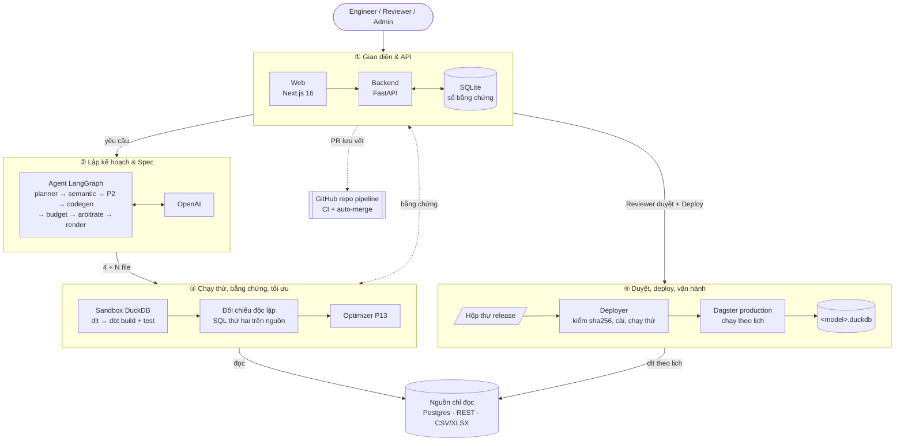

# Atomesus

> Yêu cầu dữ liệu bằng lời → agent sinh pipeline ELT (dlt → dbt → Dagster) chạy thử trên dữ liệu thật, kèm sổ bằng
> chứng và đối chiếu độc lập với nguồn → Reviewer duyệt bộ file → Deploy lên Dagster production chạy định kỳ.

**Live:** https://c4-app-045.id.vn · Dagster production: https://dagster.c4-app-045.id.vn (có mật khẩu) ·
Repo pipeline (GitOps): https://github.com/ducthais/atomesus-pipelines

| | |
|---|---|
| Kiểm thử | 1.629 test backend + 28 test tích hợp Postgres + 104 test web + 4 E2E Playwright, gate xanh trước mỗi lần deploy ([docs/testing.md](docs/testing.md)) |
| Benchmark agent | **19/20** ca với LLM thật và nguồn thật; optimizer nhanh hơn ~33% trên 3 triệu dòng ([eval/results/report.md](eval/results/report.md)) |
| Kiến trúc | [ARCHITECTURE.md](ARCHITECTURE.md) · [9 sơ đồ](docs/architecture_diagram.md) · [ADR-0001](docs/adr/0001-mot-luong-va-nen-production.md) · [SPEC.md](SPEC.md) |
| Nhật ký | [JOURNAL.md](JOURNAL.md) (tuần) · [docs/daily-log.md](docs/daily-log.md) (ngày) |

## Vấn đề

- Mỗi yêu cầu kiểu "doanh thu theo ngày", "doanh thu theo khách hàng" lặp lại cùng một chuỗi việc: tìm bảng, đọc
  schema, viết code tải dữ liệu, làm sạch, viết SQL gộp, viết test, lên lịch chạy, rồi kiểm tra số có khớp nguồn không.
- Công cụ "AI viết SQL" làm nhanh phần viết code nhưng người dùng không biết kết quả có đúng không. Lỗi thực thi như
  lệch múi giờ, ép kiểu sai, join nhân dòng hay mất dòng khi tải thường **qua được test thông thường**.
- Code do LLM viết tự do khó review, khó lặp lại; đưa thẳng lên production là rủi ro.
- Khi nguồn đổi schema (đổi tên, xóa cột) thì pipeline đang chạy lỗi mà không ai biết trước.

## Giải pháp

- **LLM chỉ viết Spec, không viết code.** Agent lập kế hoạch và viết **Spec** (bản thiết kế JSON có kiểu); code dlt /
  dbt / Dagster được **sinh tất định từ template**. Spec qua 11 cổng kiểm: đúng hợp đồng và chính sách, cột có thật ở
  nguồn, tiền tệ, join không nhân dòng, kỳ gộp đúng, giá trị lọc có thật, không mơ hồ giữa domain, biểu thức an toàn
  (AST guard), ngân sách, lịch chạy.
- **Người trong vòng lặp ở hai chỗ:** Engineer **xác nhận kế hoạch** trước khi agent viết Spec (cổng P2) và có thể xem /
  sửa mapping trước khi chạy thử; **Reviewer (không phải người tạo)** duyệt đúng bộ file đã xem (chữ ký gắn `files_hash`).
- **Chạy thử trong sandbox trên dữ liệu thật** (DuckDB riêng mỗi run) và ghi **sổ bằng chứng**: đối soát số dòng và tập
  khóa nguồn → bronze, chạy lại không đổi (idempotent), tỷ lệ và mẫu dòng bị loại ở staging, dbt test.
- **Đối chiếu độc lập:** Spec được dịch thành một câu SQL thứ hai chạy thẳng trên nguồn (không qua dlt, dbt hay
  template) và so **từng dòng** với kết quả pipeline; lệch thì agent tự sửa (vòng spec / SQL) hoặc dừng kèm chẩn đoán.
- **Optimizer P13:** sau khi chạy thử đạt, thử các luật tối ưu (incremental, lọc partition…), đo nhiều lần và **chỉ giữ
  bản cho kết quả giống hệt mà nhanh hơn**; tối ưu lại pipeline đã deploy không gọi LLM (`llm_calls = 0`).
- **Deploy an toàn:** bấm Deploy → bundle có chữ ký vào hộp thư release → deployer kiểm sha256 từng file, cài vào Dagster,
  chạy thử một lần rồi mới báo `DEPLOYED` (lỗi thì giữ bản cũ). Đồng thời mở PR lưu vết vào repo pipeline, CI kiểm chữ
  ký rồi tự merge.
- **Dùng được cho nhiều người:** đăng ký tự do, mỗi người chỉ thấy run của mình, mời Reviewer bằng link, hạn mức tiền
  LLM và số run mỗi ngày, kết nối Postgres của chính mình (mật khẩu mã hóa) hoặc tải file CSV/XLSX, xem và tải kết quả.
- **Vận hành (Day 2):** catalog trên dữ liệu thật (lineage nguồn → bronze → staging → gold, quan hệ, thuật ngữ), số đo mỗi
  lần pipeline chạy theo lịch, cảnh báo chậm / nguồn ngừng cấp, phát hiện schema nguồn đổi, đối chiếu lại theo yêu cầu.

**Giới hạn cần nói rõ:** đối chiếu độc lập kiểm tra **pipeline thực hiện đúng Spec**. Spec có đúng nhu cầu nghiệp vụ hay
không do Engineer xác nhận và Reviewer duyệt; nếu Spec hiểu sai yêu cầu, hai đường tính vẫn có thể khớp nhau.

## Người dùng

- **Engineer** (chính): data engineer nhận yêu cầu dữ liệu, tạo pipeline, kết nối nguồn của mình, mời Reviewer.
- **Reviewer**: kiểm tra bằng chứng và diff, duyệt / từ chối / yêu cầu sửa, bấm Deploy.
- **Admin**: quản lý tài khoản, cấp quyền Reviewer, xem file chính sách.
- Người dùng nghiệp vụ tra catalog để biết dữ liệu nằm ở đâu, nghĩa là gì.

## Kiến trúc



1. **Giao diện và API:** Next.js gọi FastAPI qua `/api/v1` (rewrite cùng tên miền); khóa LLM, credential nguồn và phân
   quyền nằm ở backend. Phiên đăng nhập là cookie HttpOnly + Secure; RunReport, phiên, người dùng lưu trong SQLite (WAL).
2. **Lập kế hoạch và Spec:** LangGraph gọi LLM ở `planner` (model rẻ) và `codegen` (model mạnh). Có cổng người P2 giữa
   hai bước. Spec qua đủ cổng thì `render` sinh code dlt, dbt và Dagster tất định từ `templates/`.
3. **Chạy thử, bằng chứng, tối ưu:** `test_run` chạy dlt + dbt trong DuckDB riêng của run, đối chiếu độc lập trên nguồn,
   ghi mọi check vào sổ bằng chứng; lỗi thì `repair` định tuyến vòng sửa; đạt thì `optimize` (P13) đo và giữ bản nhanh hơn.
4. **Duyệt, deploy, vận hành:** Reviewer duyệt (ký `files_hash`) rồi Deploy; backend ghi bundle bất biến vào
   `data/releases/inbox/`; service `deployer` kiểm manifest, cài vào code location Dagster, reload (không dừng job đang
   chạy), chạy thử một lần, báo kết quả qua callback ký HMAC. Mỗi pipeline ghi file DuckDB riêng.

Sơ đồ chi tiết (production, agent, luồng end-to-end, máy trạng thái, deploy, bảo mật):
[docs/architecture_diagram.md](docs/architecture_diagram.md). Đặc tả: [SPEC.md](SPEC.md); thay đổi so với đặc tả:
[ADR-0001](docs/adr/0001-mot-luong-va-nen-production.md). Chính sách áp cho mọi run nằm trong [`policy/`](policy/):
`domains.yml` (domain, nguồn, thực thể, thuật ngữ, tỷ giá), `budgets.yml` (trần chi phí, số lần gọi LLM, số vòng sửa,
hạn mức mỗi người), `objectives.yml` (độ tươi dữ liệu).

## Tech stack

| Lớp | Công nghệ |
|---|---|
| Agent | LangGraph; OpenAI `gpt-4o-mini` lập kế hoạch, model mạnh viết Spec (`MODEL_NAME`, `MODEL_NAME_STRONG`), `temperature=0`, đầu ra JSON |
| Kiểm Spec | Pydantic + JSON Schema, sqlglot (AST guard) |
| Sinh code | Jinja templates (`templates/`, delimiter `[[ ]]`): dlt, dbt staging + gold + test, Dagster asset |
| Backend | FastAPI + Uvicorn, Python 3.11, pydantic-settings |
| Nguồn dữ liệu | PostgreSQL 16 (`sales_raw`, `pagila`), REST qua OpenAPI, thư mục CSV, file CSV/XLSX tải lên, Postgres của người dùng |
| Chạy thử / warehouse | DuckDB, dlt, dbt-duckdb |
| Lịch chạy | Dagster 1.13 (code location hợp nhất, reload qua GraphQL) |
| Sổ bằng chứng | SQLite (WAL) |
| Frontend | Next.js 16 (App Router) + React 19 + TypeScript, Monaco, lucide |
| Hạ tầng | Azure VM B2s, Docker Compose, Caddy (HTTPS tự động), tên miền riêng |
| Kiểm thử | pytest, ruff, `node --test`, Playwright, harness gate (pytest trong Docker + chụp UI), eval 20 ca |

## Chạy dự án

Cần: **Python 3.11**, **Node 24**, **Docker Desktop**, Git. Lệnh chạy từ thư mục gốc repo.

### 1. Cài đặt

```bash
python -m venv .venv
.venv\Scripts\activate                 # macOS / Linux: source .venv/bin/activate
pip install -r requirements.txt -r requirements/dagster.txt
cd web && npm ci && cd ..
```

### 2. Cấu hình

Mọi cấu hình nằm trong **một file `.env` ở thư mục gốc** (không đưa lên Git), mẫu ở `.env.example`:

```bash
cp .env.example .env                   # điền OPENAI_API_KEY; các biến khác xem mục Cấu hình
python scripts/setup_pipeline.py       # sinh mật khẩu Postgres nguồn vào .env (đã có thì giữ nguyên)
```

### 3. Khởi động (5 terminal)

```bash
# Postgres nguồn: tự nạp dữ liệu mẫu sales_raw và pagila khi volume còn trống
docker compose --env-file .env -p p045-b -f infra/postgres/compose.yml up -d --build --wait

# Mock REST API (nguồn sales_api, mkt_api, review_api): cổng 8100
make mock-api

# Backend: http://localhost:8000 (Swagger ở /docs)
uvicorn src.main:app --port 8000

# Dagster: http://127.0.0.1:3070 (nạp lại khi có pipeline mới được deploy)
python scripts/dagster_local.py

# Web: http://localhost:3000
cd web && npm run dev
```

Kiểm tra mọi thứ đã sẵn sàng (phải ra "Sẵn sàng demo."): `python scripts/demo_check.py`.

Tài khoản local: `engineer` / `Engineer@123` (Engineer), `reviewer` / `Reviewer@123` (Reviewer), `admin` / `Admin@123`
(Admin). Hoặc **Đăng ký** tài khoản Engineer mới trên màn đăng nhập; Reviewer được Engineer mời bằng link hoặc Admin
cấp quyền. `APP_ENV=production` chặn đăng nhập bằng mật khẩu mặc định.

Chạy cả sản phẩm như production bằng Docker Compose (Caddy, web, backend, Dagster, deployer, Postgres, mock API):
[docs/deploy.md](docs/deploy.md).

### Dữ liệu mẫu

| Nguồn | Loại | Nội dung |
|---|---|---|
| `sales_pg` (domain `sales`, ẩn khỏi luồng tạo mới) | Postgres `sales_raw` | `customers`, `orders` (30 đơn, số tiền và ngày dạng chuỗi, bẩn có chủ đích) |
| `pagila_pg` (domain `rental`) | Postgres `pagila` | Bộ Pagila cho thuê DVD: 15 bảng, 21 khóa ngoại, 32.093 giao dịch |
| `sales_api`, `mkt_api` | REST (mock, OpenAPI) | 122 khoản thanh toán cho 30 đơn, có bản ghi lặp, USD, `N/A` |
| `review_api` | REST (mock) | Phản hồi và điểm đánh giá của khách thuê DVD |
| `landing_sales` | Thư mục CSV | Hoàn tiền theo tháng, ngày ghi hai kiểu |
| `landing_bench` | Thư mục CSV sinh lúc chạy | 3 triệu dòng sự kiện cho benchmark optimizer (`eval/bench/make_events.py`) |
| `conn:<id>` | Postgres của người dùng | Thêm ở trang **Nguồn dữ liệu**, chọn schema và bảng |
| file tải lên | CSV / XLSX | Mỗi file CSV hoặc mỗi sheet XLSX thành một bảng |

Dữ liệu Postgres nằm sẵn trong repo (`infra/postgres/init/`). Volume cũ chưa có Pagila thì nạp bằng
`python scripts/load_pagila.py`.

## Luồng sử dụng

1. **Engineer → Yêu cầu pipeline:** chọn nguồn và bảng, nhập yêu cầu bằng lời (ví dụ "Tính doanh thu và số đơn hàng theo
   từng ngày"); có thể gửi nhiều yêu cầu cùng lúc trong hạn mức ngày.
2. Agent lập kế hoạch rồi **dừng chờ xác nhận** (P2): tab **Kế hoạch** hiện bảng nguồn, cách ghép, độ hạt, chỉ số, lịch.
   Engineer sửa hoặc **Xác nhận kế hoạch**; để tích "Xem & chỉnh mapping" thì dừng tiếp ở bản nháp để sửa mapping.
3. Agent viết Spec, sinh code, chạy thử trên dữ liệu thật, tự sửa nếu cần, chạy optimizer. Tab **Kết quả** diễn giải
   pipeline bằng lời và hiện dữ liệu; tab **Bằng chứng** liệt kê mọi phép đo; tab **Staging** hiện dòng bị loại và lý do.
4. Engineer **mời Reviewer** (trang Reviewer) nếu chưa có. Reviewer đọc **tóm tắt** ở đầu màn duyệt, xem diff, **So sánh**
   với bản đang chạy, rồi **Phê duyệt**, **Từ chối** hoặc **Yêu cầu sửa** (agent chạy lại từ bước viết Spec).
5. Reviewer bấm **Deploy**: khung Triển khai hiện từng bước (đã gửi deployer → chạy thử → production). PR lưu vết được mở
   vào repo pipeline và tự merge khi CI xanh.
6. Pipeline chạy theo lịch trên Dagster; **Theo dõi** hiện thời gian, chi phí, test dbt và cảnh báo; **Kết quả** cho xem
   và tải bảng gold (CSV/XLSX); nút **Tối ưu** chạy lại optimizer không gọi LLM.

Đo thời gian làm tay so với dùng agent: [docs/time-study.md](docs/time-study.md).

## Cấu trúc thư mục

```
src/
  agents/            Agent LangGraph: graph, nodes (planner, semantic, codegen, budget, arbitrate, render,
                     sandbox_run, repair, optimize), prompts, router sửa lỗi, optimizer, tối ưu thủ công, hàng loạt
  spec/              Hợp đồng Spec (pydantic + JSON Schema), cổng kiểm theo chính sách
  codegen/           Render template, AST guard, sandbox chạy thử, đối chiếu độc lập (reference.py), bundle release, GitHub
  run_report/        Sổ bằng chứng (RunReport), quyền xem, duyệt / từ chối / yêu cầu sửa / Deploy, so sánh phiên bản
  pipeline/          Phiên, người dùng, lời mời, hạn mức, kết nối Postgres người dùng, file tải lên, nguồn REST
  api/               Catalog (khám phá nguồn, drift, đối chiếu lại), chính sách, kết quả, theo dõi, webhook / callback
  deployer/          Service deployer: hộp thư release, kiểm manifest, cài + chạy thử + rollback
  dagster_runtime/   Code location hợp nhất, credential theo nguồn, DuckDB riêng mỗi pipeline
  monitor/           Số đo mỗi lần chạy theo lịch, cảnh báo Day 2
  chat/              Chat trên run: hỏi đáp, sửa pipeline bằng lời
  policy/            Đọc policy/*.yml, chính sách hiệu lực theo người dùng
  orchestration/     Trạng thái Dagster qua GraphQL
templates/           Jinja: dlt_pipeline.py, dbt_staging.sql, dbt_model.sql, dbt_schema.yml, dagster_asset.py
dbt_project/         Khung dbt dùng chung (profiles, macros)
policy/              domains.yml, budgets.yml, objectives.yml
infra/               Postgres nguồn (Docker, dữ liệu mẫu), mock REST API, thư mục CSV mẫu
web/                 Next.js: landing, catalog, studio, duyệt, theo dõi, kết quả, tài khoản (xem web/README.md)
deploy/              compose.yml production, Caddyfile, setup-vm.sh, push.ps1, bản mẫu repo pipeline
eval/                Benchmark 20 ca: cases/, golden/, bench/, results/ (report.md, latest.md)
scripts/             harness (gate, deploy, smoke), dagster_local, deployer, demo_check, seed, hook ghi AI log
tests/               pytest (không cần Postgres; dbt chạy thật trên DuckDB)
pipeline_tests/      Test tích hợp với Postgres thật
docs/                Tài liệu (mục lục: docs/README.md); guide/ là tài liệu khóa học
data/                Sinh lúc chạy, không đưa lên Git
```

## API chính

Tiền tố `/api/v1`, đăng nhập bằng cookie phiên (`POST /pipeline/session`). Đầy đủ ở Swagger `/docs`.

| Method | Path | Làm gì |
|---|---|---|
| POST | `/pipeline/session`, `/pipeline/register` | Đăng nhập; đăng ký tài khoản Engineer |
| GET | `/pipeline/quota`, `/pipeline/limits` | Hạn mức còn lại hôm nay; giới hạn mỗi run |
| POST | `/pipeline/invites`, `/pipeline/invites/accept` | Engineer tạo link mời Reviewer; người nhận chấp nhận |
| PATCH | `/pipeline/users/{id}/role` | Admin cấp / thu hồi quyền Reviewer |
| POST | `/agent/runs`, `/agent/runs/batch` | Gửi một / nhiều yêu cầu; agent lập kế hoạch ở nền rồi chờ xác nhận |
| POST | `/agent/runs/{id}/confirm-plan` | Engineer sửa (tùy chọn) và xác nhận kế hoạch |
| POST | `/agent/runs/{id}/continue` | Chạy thử bản nháp với Spec / mapping đã sửa |
| GET | `/runs`, `/runs/{id}`, `/runs/{id}/files`, `/runs/{id}/compare` | Sổ bằng chứng theo quyền xem; file; so sánh phiên bản |
| POST | `/runs/{id}/approve`, `/reject`, `/request-changes`, `/cancel` | Duyệt (ký `files_hash`), từ chối, yêu cầu sửa, hủy |
| POST | `/runs/batch-review` | Duyệt hoặc từ chối tối đa 50 run |
| POST | `/runs/{id}/deploy` | Reviewer / Admin đưa bản đã duyệt lên production |
| GET | `/pipeline/deploy-config` | Chế độ deploy (`direct` / `pr`) và có PR lưu vết không |
| POST | `/pipelines/{model}/optimize` | Tối ưu pipeline đã deploy, không gọi LLM |
| GET/POST | `/connections`, `/connections/{id}/schemas`, `/tables`, `/selection` | Kết nối Postgres của người dùng, chọn bảng |
| POST | `/uploads`, PUT `/uploads/{id}/selection` | Tải file CSV/XLSX làm nguồn, chọn bảng |
| GET | `/results/{model}`, `/results/{model}/export` | Bảng gold phân trang; tải CSV/XLSX |
| GET | `/catalog`, `/catalog/sources/{ref}/objects`, `/catalog/drift` | Catalog; đọc bảng, khóa; schema nguồn đổi |
| POST | `/catalog/datasets/{domain}/{model}/reconcile` | Đối chiếu lại bảng gold với nguồn |
| GET | `/monitor/pipelines`, `/monitor/alerts` | Số đo Day 2, cảnh báo |
| GET | `/policy` | Chính sách (file YAML chỉ cho Admin) |
| POST | `/webhooks/github`, `/deployments/callback` | Sự kiện GitHub; callback deployer (ký HMAC) |

## Cấu hình

| Biến | Ý nghĩa |
|---|---|
| `OPENAI_API_KEY`, `MODEL_NAME`, `MODEL_NAME_STRONG` | Khóa LLM; model lập kế hoạch / viết Spec (mặc định `gpt-4o-mini`) |
| `POSTGRES_PASSWORD`, `PIPELINE_READER_PASSWORD`, `PIPELINE_DATABASE_URL` | Postgres nguồn và tài khoản chỉ đọc (do `setup_pipeline.py` sinh) |
| `APP_ENV` | `production` chặn mật khẩu mặc định, bật các ràng buộc production |
| `PIPELINE_CONNECTION_KEY`, `PIPELINE_EGRESS_IP` | Khóa Fernet mã hóa kết nối của người dùng; IP người dùng cần mở firewall |
| `PIPELINE_DEPLOY_MODE`, `PIPELINE_DEPLOYER_SECRET`, `PIPELINE_RELEASE_DIR` | Chế độ deploy (`direct` mặc định / `pr`), khóa ký callback, hộp thư release |
| `PIPELINE_GITHUB_TOKEN`, `PIPELINE_GITHUB_REPO` | Bật PR lưu vết vào repo pipeline |
| `PIPELINE_MAX_PARALLEL_SANDBOX`, `PIPELINE_MAX_PARALLEL_PLANNING` | Số sandbox / lượt lập kế hoạch chạy đồng thời |
| `PIPELINE_AZURE_STORAGE_CONNECTION_STRING`, `PIPELINE_AZURE_STORAGE_CONTAINER` | Đo byte quét từ metadata Parquet trên Azure Blob |
| `PIPELINE_WAREHOUSE_TIMEZONE` | Múi giờ DuckDB khi chạy thử, phải là `UTC` |
| `AI_LOG_SERVER`, `AI_LOG_API_KEY` | Gửi AI log lên server chấm |
| `PIPELINE_BACKEND_URL`, `CATALOG_MOCK` (môi trường `web/`) | Địa chỉ backend; `CATALOG_MOCK=1` chạy giao diện với dữ liệu mock |

Danh sách đầy đủ kèm giải thích: `.env.example`.

## Kiểm thử

```bash
python -m pytest tests -q                                  # backend (venv đã activate để có lệnh dbt)
ruff check src tests && ruff format --check src tests
cd web && npm run typecheck && npm test && npm run build   # web
cd web && npm run test:e2e                                 # E2E Playwright
python -m pytest pipeline_tests                            # tích hợp, cần Postgres nguồn
python scripts/harness.py verify-main                      # gate đầy đủ như trước deploy (cần Docker)
```

Kết quả lần chạy gần nhất (2026-10-18): **1.629 passed, 2 skipped** (backend), **28/28** (tích hợp Postgres), **104/104**
(web unit), **4/4** (E2E), ruff sạch, gate `verify-main` xanh trên bản production `ea7c2c1`. Chiến lược, bộ test theo module, 8 bất biến, cách đọc kết quả:
[docs/testing.md](docs/testing.md).

## Benchmark

`eval/run_eval.py` chạy agent thật (OpenAI) trên nguồn thật, 20 ca: 7 hợp lệ (so golden từng dòng), 6 vi phạm (phải
chặn đúng cổng), 3 mơ hồ (phải hỏi lại), 4 optimizer (đo trước / sau, gồm ca 3 triệu dòng).

```bash
docker compose --env-file .env -p p045-b -f infra/postgres/compose.yml up -d --build --wait
make mock-api        # terminal riêng
make eval            # = python eval/run_eval.py; ~35 phút, vài cent tiền LLM; ghi eval/results/latest.md
```

Kết quả lượt chính thức (2026-10-17 19:37 UTC, seed hiện tại của repo):

| Nhóm | Kết quả | Ghi chú |
|---|---|---|
| Hợp lệ: gold khớp golden từng dòng | **6/7** | Postgres, REST, CSV, đa nguồn; ca trượt: AVG qua chuỗi ghép 1–n (`pagila` + `review_api`) |
| Vi phạm: chặn đúng cổng | **6/6** | AST guard 2/2, ngân sách 2/2, xung đột ngữ nghĩa 2/2 |
| Mơ hồ: hỏi lại thay vì đoán | **3/3** | |
| Optimizer đúng hành vi | **4/4** | bảng nhỏ: bỏ bản "tối ưu" chậm hơn; 3 triệu dòng: giữ bản **nhanh hơn 34,2%** (P13) / **32,1%** (tối ưu thủ công, `llm_calls = 0`), gold giống hệt |
| **Tổng** | **19/20** | tiền LLM $0,0235 cả lượt; 1.595 giây (ca 3 triệu dòng 969 giây) |

Benchmark đợt này tìm ra và đã sửa một hồi quy (thiếu định dạng ngày `%Y/%m/%d`) và một lỗi planner; năm lượt chạy, nguyên
nhân từng thay đổi và việc còn lại: [eval/results/report.md](eval/results/report.md). Bảng từng ca:
[eval/results/latest.md](eval/results/latest.md).

## Ghi log sử dụng AI (yêu cầu của khóa học)

Cài hook một lần sau khi clone (cần `AI_LOG_SERVER`, `AI_LOG_API_KEY` trong `.env`):

```bash
bash scripts/setup_hooks.sh                                          # macOS / Linux / Git Bash
powershell -ExecutionPolicy Bypass -File scripts\setup_hooks.ps1     # Windows PowerShell
```

Hook ghi prompt của Claude Code, Cursor, Codex CLI, Gemini CLI, Antigravity, GitHub Copilot vào
`.ai-log/session.jsonl` và gửi lên server chấm ở bước `git push` (gửi tay: `python scripts/submit_log.py` từ thư mục repo
có `.env`). Công cụ web (ChatGPT…) thì ghi tay: `bash scripts/_pyrun.sh scripts/log_manual.py --tool chatgpt --prompt "..."`.

## Deliverables

| # | Hạng mục | Trạng thái | Ở đâu |
|---|---|---|---|
| 1 | Source code | ✅ | repo này (`src/`, `web/`, `templates/`, `deploy/`, `eval/`) |
| 2 | README.md | ✅ | file này |
| 3 | Sơ đồ kiến trúc | ✅ | [docs/architecture_diagram.md](docs/architecture_diagram.md), [ARCHITECTURE.md](ARCHITECTURE.md) |
| 4 | Tài liệu đặc tả & thiết kế | ✅ | [docs/README.md](docs/README.md): [SPEC.md](SPEC.md), [ADR-0001](docs/adr/0001-mot-luong-va-nen-production.md), [policy/](policy/) |
| 5 | Tài liệu kiểm thử | ✅ | [docs/testing.md](docs/testing.md), [eval/results/report.md](eval/results/report.md) |
| 6 | Nhật ký tuần | ✅ | [JOURNAL.md](JOURNAL.md), worklog ngày [docs/daily-log.md](docs/daily-log.md) |
| 7 | Live URL | ✅ | https://c4-app-045.id.vn |
| 8 | Video demo | ⏳ | nhóm bổ sung (`presentation/`) |
| 9 | Pitch deck | ⏳ | nhóm bổ sung (`presentation/`) |
| 10 | AI log | ✅ | hook ghi `.ai-log/`, gửi lên server chấm |

## Team

| Thành viên (GitHub) | Phụ trách chính | MSSV |
|---|---|---|
| Đinh Đức Thái (`ducthais`) | Agent và các cổng, sinh code + sandbox + đối chiếu độc lập, deploy production (Azure, deployer, GitOps), harness, eval, đa người dùng, kết nối nguồn của người dùng | |
| Trần Hồng Sơn (`HongSon507`) | Hợp đồng RunReport / Spec / chính sách, chat, eval 15 ca, optimizer P13, đo byte trên Azure, Dagster runtime, nguồn `review_api` | |
| `bobui147` | Giao diện Pipeline Studio và landing page, đăng nhập / đăng ký / quản lý tài khoản, luồng review và vận hành, tạo hàng loạt, giao diện mới | |
| `cuongphanhp` | Môi trường `uv`, tài liệu kiến trúc, chọn vai nhanh khi đăng nhập, test tải kết quả | |

## Tài liệu khác

- Mục lục tài liệu: [docs/README.md](docs/README.md).
- [`web/README.md`](web/README.md): giao diện, các màn hình và API tương ứng.
- [`docs/deploy.md`](docs/deploy.md): dựng VM, cấu hình, deploy, deployer, chế độ `direct` / `pr`.
- [`docs/guide/`](docs/guide/): Technical Guidebook của khóa AI20K (tài liệu tham khảo, không mô tả dự án này).
- Đóng góp: [CONTRIBUTING.md](CONTRIBUTING.md). Báo lỗ hổng bảo mật: [SECURITY.md](SECURITY.md).

## License

[MIT](LICENSE)
