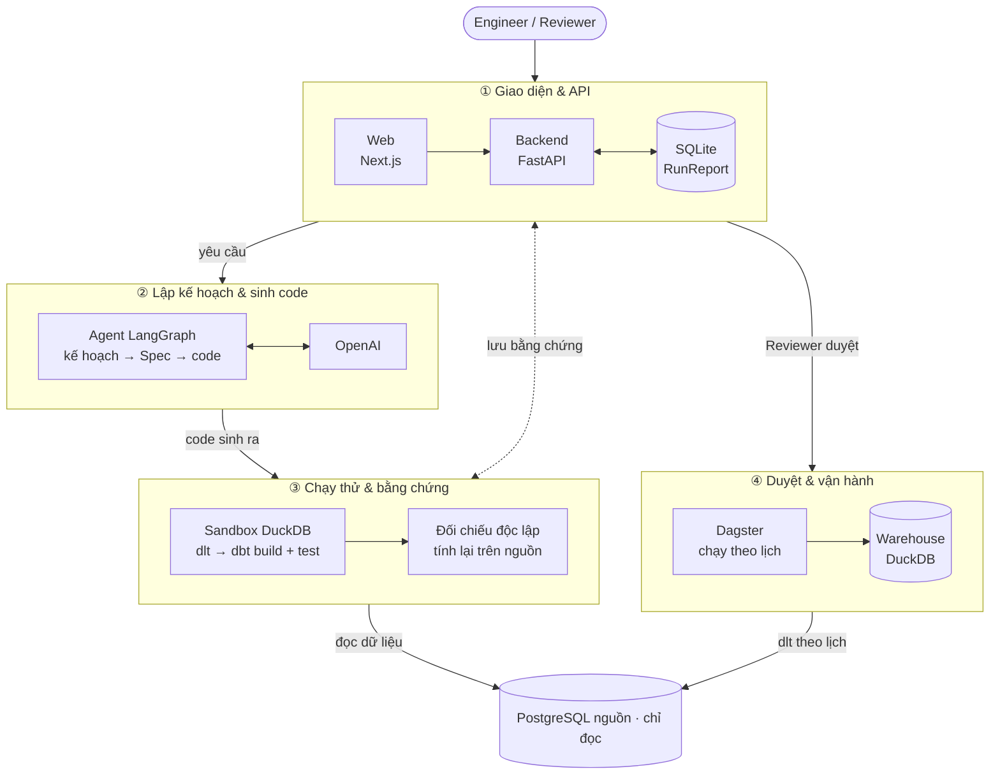

# Atomesus

> Yêu cầu dữ liệu bằng lời → agent sinh pipeline ELT (dlt → dbt → Dagster) chạy thử trên dữ liệu thật, kèm sổ bằng
> chứng và đối chiếu độc lập với nguồn, rồi người duyệt trước khi chạy định kỳ. Dành cho đội data engineering.

## Vấn đề

- Mỗi yêu cầu kiểu "doanh thu theo ngày", "doanh thu theo khách hàng" lặp lại cùng một chuỗi việc: tìm bảng, đọc
  schema, viết code tải dữ liệu, làm sạch, viết SQL gộp, viết test, lên lịch chạy, rồi kiểm tra số có khớp nguồn không.
- Công cụ "AI viết SQL" làm nhanh phần viết code nhưng người dùng không biết kết quả có đúng không. Lỗi thực thi như
  lệch múi giờ, ép kiểu sai hay mất dòng khi tải thường **qua được test thông thường**: tổng vẫn khớp, chỉ từng dòng
  bị đặt sai chỗ.
- Khi nguồn đổi schema (đổi tên, xóa cột) thì pipeline đang chạy lỗi mà không ai biết trước.

## Giải pháp

- **Catalog trên dữ liệu thật:** kết nối nguồn khi cần, xem bảng, cột, khóa, quan hệ (sơ đồ ER), lineage
  nguồn → bronze → staging → gold, thuật ngữ nghiệp vụ, steward của từng domain.
- **Agent sinh pipeline từ yêu cầu bằng lời:** LLM chỉ viết kế hoạch và **Spec** (bản thiết kế JSON); code dlt / dbt /
  Dagster được **sinh tất định từ template**, không phải LLM viết tự do. Spec qua các cổng kiểm tra: đúng hợp đồng
  và chính sách, cột có thật ở nguồn, gộp đúng kỳ yêu cầu (ngày / tuần / tháng…), biểu thức an toàn.
- **Engineer xem và chỉnh mapping trước khi chạy thử** (bản nháp): đổi tên, kiểu, định dạng ngày, thêm / bỏ cột, luật
  loại dòng, kỳ gộp. Bấm chạy thử là Engineer xác nhận Spec đúng nhu cầu.
- **Chạy thử trong sandbox trên dữ liệu thật** (DuckDB riêng cho mỗi run), ghi mọi phép đo vào **sổ bằng chứng**:
  đối soát số dòng nguồn → bronze, tỷ lệ dòng rác ở staging, dbt test, dữ liệu kết quả mẫu.
- **Đối chiếu độc lập với nguồn:** Spec được dịch thành một câu SQL chạy thẳng trên Postgres (không qua dlt, DuckDB,
  dbt hay template) và so **từng dòng** với kết quả của pipeline; lệch thì run bị chặn, kèm chẩn đoán (ví dụ lệch đúng
  +7 giờ là lỗi múi giờ).
- **Người duyệt và Dagster:** Reviewer (không phải người tạo) duyệt đúng bộ file đã xem; hệ thống ghi project Dagster,
  lịch chạy định kỳ, catalog đọc trạng thái chạy từ Dagster. Có so sánh phiên bản và ảnh hưởng tới pipeline khác trước
  khi duyệt, phát hiện schema nguồn đổi, và khung **thời gian & công sức** (máy chạy bao lâu, người mất bao lâu).

**Giới hạn cần nói rõ:** đối chiếu độc lập kiểm tra **pipeline thực hiện đúng Spec**. Spec có đúng nhu cầu nghiệp vụ hay
không do Engineer xác nhận và Reviewer duyệt; nếu Spec hiểu sai yêu cầu, hai đường tính vẫn có thể khớp nhau. Hệ thống
không hứa "đảm bảo đúng business logic".

## Người dùng

- **Chính:** Data engineer nhận yêu cầu dữ liệu và phải dựng pipeline (vai trò `Engineer`).
- **Phụ:** Người duyệt / data steward kiểm tra bằng chứng trước khi pipeline chạy định kỳ (vai trò `Reviewer`); người
  dùng nghiệp vụ tra catalog để biết dữ liệu nằm ở đâu, nghĩa là gì.

## Kiến trúc



Luồng được chia thành bốn phần rõ ràng:

1. **Giao diện và API:** Next.js chỉ gọi FastAPI qua `/api/v1`; thông tin kết nối nguồn, khóa LLM và logic phân quyền
   nằm ở backend. Phiên đăng nhập dùng cookie HttpOnly, token băm và RunReport được lưu trong SQLite.
2. **Lập kế hoạch và sinh code:** LangGraph gọi LLM ở hai bước `planner` và `codegen` để tạo kế hoạch + Spec. Sau khi
   Spec qua kiểm tra schema / policy, node `render` mới sinh code dlt, dbt và Dagster một cách tất định từ `templates/`.
3. **Chạy thử và ghi bằng chứng:** node `test_run` dùng dlt đọc Postgres vào DuckDB riêng của run, chạy dbt + test,
   rồi chạy một câu SQL độc lập trực tiếp trên Postgres để đối chiếu kết quả. Toàn bộ checks, timeline, file sinh ra và
   dữ liệu mẫu được ghi vào `data/pipeline/runs.sqlite3` để Reviewer xem.
4. **Duyệt và vận hành:** chỉ khi Reviewer phê duyệt, backend mới ghi project vào `data/dagster_local/`.
   `scripts/dagster_local.py` phát hiện `workspace.yaml` thay đổi, khởi động lại Dagster và các pipeline đã duyệt chạy
   vào warehouse chung `data/warehouse/warehouse.duckdb`; backend đọc trạng thái Dagster qua GraphQL.

Đặc tả đầy đủ (luồng P0–P14, bất biến, cổng kiểm tra): [`SPEC.md`](SPEC.md). Chính sách mà backend áp dụng cho mọi
run nằm trong [`policy/`](policy/): `domains.yml` (domain, nguồn, thuật ngữ, tỷ giá), `budgets.yml` (trần số lần gọi
LLM, số lần sửa Spec, thời gian mỗi bước), `objectives.yml` (ngưỡng chất lượng).

## Tech stack

| Lớp | Công nghệ |
|---|---|
| Agent | LangGraph; LLM OpenAI, mặc định `gpt-4o-mini` (`MODEL_NAME`, `MODEL_NAME_STRONG` trong `src/config.py`) |
| Sinh code | Jinja templates (`templates/`): dlt, dbt (staging + gold + test), Dagster asset |
| Backend | FastAPI + Uvicorn, Python 3.11, pydantic |
| Nguồn dữ liệu | PostgreSQL 16 trong Docker (`sales_raw`, `pagila`), tài khoản chỉ đọc |
| Chạy thử / warehouse | DuckDB, dlt, dbt-duckdb |
| Lịch chạy | Dagster 1.13 (local) |
| Sổ bằng chứng | SQLite (`data/pipeline/runs.sqlite3`) |
| Frontend | Next.js 16 (App Router) + React 19 + TypeScript, Monaco |
| Kiểm thử | pytest, ruff, `node --test`, GitHub Actions |

## Chạy dự án

Cần: **Python 3.11**, **Node 24**, **Docker Desktop**, Git. Lệnh chạy từ thư mục gốc repo.

### 1. Cài đặt

```bash
python -m venv .venv
.venv\Scripts\activate                 # macOS / Linux: source .venv/bin/activate
pip install -r requirements.txt -r requirements/dagster.txt
cd web && npm ci && cd ..
```

### 2. Cấu hình

Mọi cấu hình nằm trong **một file `.env` ở thư mục gốc** (không đưa lên Git), mẫu ở `.env.example`:

```bash
cp .env.example .env                   # điền OPENAI_API_KEY; các biến khác xem mục Cấu hình
python scripts/setup_pipeline.py       # sinh mật khẩu Postgres nguồn vào .env (đã có thì giữ nguyên)
```

Máy nào còn file cũ `infra/postgres/.env` thì `setup_pipeline.py` tự chép mật khẩu sang `.env`, sau đó xóa file cũ.

### 3. Khởi động (4 terminal)

```bash
# Postgres nguồn: tự nạp dữ liệu mẫu sales_raw và pagila khi volume còn trống
docker compose --env-file .env -p p045-b -f infra/postgres/compose.yml up -d --build --wait

# Backend: http://localhost:8000 (Swagger ở /docs)
uvicorn src.main:app --port 8000

# Dagster: http://127.0.0.1:3070 (tự khởi động lại khi có pipeline mới được duyệt)
python scripts/dagster_local.py

# Web: http://localhost:3000
cd web && npm run dev
```

Kiểm tra mọi thứ đã sẵn sàng (phải ra "Sẵn sàng demo."): `python scripts/demo_check.py`.

Đăng nhập bằng một trong hai tài khoản local:

- `engineer` / `Engineer@123` — **Minh · Engineer**, tạo và chạy thử pipeline.
- `reviewer` / `Reviewer@123` — **An · Reviewer**, kiểm tra và phê duyệt.

Muốn đổi vai trò, đăng xuất rồi đăng nhập bằng tài khoản còn lại. Có thể đổi hai mật khẩu mặc định bằng
`PIPELINE_ENGINEER_PASSWORD` và `PIPELINE_REVIEWER_PASSWORD` trong `.env`.

### Dữ liệu mẫu

| Nguồn | Schema | Nội dung |
|---|---|---|
| `sales_pg` (domain `sales`) | `sales_raw` | 2 bảng: `customers`, `orders` (30 đơn, số tiền và ngày dạng chuỗi) |
| `pagila_pg` (domain `rental`) | `pagila` | Bộ Pagila cho thuê DVD: 15 bảng, 21 khóa ngoại, 32.093 giao dịch |

Cả hai nằm sẵn trong repo (`infra/postgres/init/`), **không cần tải gì thêm**. Postgres tạo từ trước khi repo có Pagila
(volume cũ không chạy lại script khởi tạo) thì nạp bằng:

```bash
python scripts/load_pagila.py            # thêm --replace để nạp lại
```

Bấm **Kết nối** `pagila_pg` mà báo "Schema 'pagila' chưa có trong Postgres nguồn" là trường hợp này.

## Luồng sử dụng

1. **Yêu cầu pipeline** → chọn nguồn và bảng (kết nối trực tiếp lúc bấm) → nhập yêu cầu bằng lời, ví dụ "Tính doanh
   thu và số đơn hàng theo từng ngày".
2. Agent lập kế hoạch (vài giây) rồi **dừng chờ xác nhận** (cổng P2): tab **Kế hoạch** hiện bảng nguồn, cách ghép,
   độ hạt, chỉ số, lịch chạy. Engineer bấm **Xác nhận kế hoạch** thì agent mới viết Spec. Nếu để tích "Xem & chỉnh
   mapping", agent dừng tiếp ở **bản nháp**: Engineer kiểm tra / sửa mapping rồi bấm chạy thử.
3. Agent sinh code từ template và chạy thử trên dữ liệu thật (khoảng 15–20 giây). Tab **Kết quả** diễn giải pipeline bằng
   lời, hiện dữ liệu kết quả và kết quả đối chiếu với nguồn; tab **Bằng chứng** liệt kê mọi phép đo.
4. Reviewer xem bằng chứng, tab **So sánh** (khác gì bản đang chạy, ảnh hưởng tới pipeline khác) rồi **Phê duyệt**.
5. Dagster nạp pipeline mới (1–2 phút), chạy theo lịch; trang dataset hiện trạng thái chạy, nút **Đối chiếu lại** với
   nguồn, và cảnh báo khi schema nguồn đổi.

Kịch bản demo 15 phút: [`docs/demo.md`](docs/demo.md). Đo thời gian làm tay so với dùng agent:
[`docs/time-study.md`](docs/time-study.md).

## Cấu trúc thư mục

```
src/
  agents/          Agent LangGraph: graph, nodes (planner, codegen, render, sandbox_run), prompts, validate (cổng Spec)
  api/             FastAPI: agent, catalog (khám phá nguồn, drift, đối chiếu lại), policy, orchestration
  codegen/         Render template, sandbox chạy thử, đối chiếu độc lập (reference.py), deploy Dagster local
  pipeline/        Kết nối Postgres, connector khám phá nguồn, đăng nhập demo, settings
  run_report/      Sổ bằng chứng (RunReport), duyệt / từ chối, so sánh phiên bản, phát hiện schema đổi
  spec/            Hợp đồng Spec (pydantic + JSON schema), kiểm tra theo chính sách
  policy/          Đọc policy/*.yml
  orchestration/   Đọc trạng thái Dagster qua GraphQL
templates/         Jinja: dlt_pipeline.py, dbt_staging.sql, dbt_model.sql, dbt_schema.yml, dagster_asset.py
dbt_project/       Khung dbt dùng chung (profiles, macros)
policy/            domains.yml, budgets.yml, objectives.yml
infra/postgres/    Postgres nguồn (Docker) + script khởi tạo, dữ liệu mẫu Pagila
web/               Next.js: catalog, quan hệ, yêu cầu pipeline, run, duyệt (xem web/README.md)
scripts/           dagster_local, demo_check, load_pagila, setup_pipeline, seed..., hook ghi log AI
tests/             pytest (không cần Postgres; dbt chạy thật trên DuckDB)
pipeline_tests/    Test tích hợp với Postgres thật
fixtures/          Spec và RunReport mẫu
docs/              demo.md, time-study.md, task-b.md, task-c.md, architecture_diagram.md, guide/ (tài liệu khóa học)
data/              Sinh lúc chạy, không đưa lên Git: sổ bằng chứng, warehouse và project Dagster local
```

## API chính

Tiền tố `/api/v1`, đăng nhập bằng cookie phiên (`POST /pipeline/session`). Đầy đủ ở Swagger `/docs`.

| Method | Path | Làm gì |
|---|---|---|
| POST | `/agent/runs` | Gửi yêu cầu; trả ngay, agent lập kế hoạch ở nền rồi dừng chờ xác nhận (DRAFT, stage `confirm`) |
| POST | `/agent/runs/{id}/confirm-plan` | Engineer tạo run xác nhận kế hoạch; body `{review_mapping}`: dừng ở bản nháp để xem mapping |
| POST | `/agent/runs/{id}/continue` | Chạy thử bản nháp với Spec đã xác nhận / sửa |
| GET | `/runs`, `/runs/{id}` | Sổ bằng chứng |
| GET | `/runs/{id}/compare` | So với bản đang chạy / bản trước, ảnh hưởng nếu duyệt |
| POST | `/runs/{id}/approve`, `/runs/{id}/reject` | Reviewer duyệt (ghi project Dagster) hoặc từ chối |
| GET | `/catalog`, `/catalog/sources/{ref}/objects` | Catalog; kết nối nguồn và đọc bảng, khóa |
| GET | `/catalog/drift` | Schema nguồn của pipeline đang chạy có đổi không |
| POST | `/catalog/datasets/{domain}/{model}/reconcile` | Đối chiếu lại bảng gold Dagster với nguồn |
| GET | `/orchestration/status` | Trạng thái chạy từ Dagster |
| GET | `/policy` | Chính sách đang áp dụng |

## Cấu hình

| Biến | Ở đâu | Ý nghĩa |
|---|---|---|
| `OPENAI_API_KEY` | `.env` | Khóa LLM (bắt buộc để tạo pipeline) |
| `MODEL_NAME`, `MODEL_NAME_STRONG` | `.env` | Model lập kế hoạch / viết Spec (mặc định `gpt-4o-mini`) |
| `POSTGRES_PASSWORD`, `PIPELINE_READER_PASSWORD`, `PIPELINE_DATABASE_URL` | `.env` | Mật khẩu Postgres nguồn và kết nối bằng tài khoản chỉ đọc (do `setup_pipeline.py` sinh) |
| `PIPELINE_WAREHOUSE_TIMEZONE` | `.env` | Múi giờ DuckDB khi chạy thử, **phải là `UTC`** (mặc định). Đặt khác để tái hiện lỗi lệch giờ trong demo |
| `PIPELINE_DAGSTER_URL` | `.env` | Dagster local (mặc định `http://127.0.0.1:3070`) |
| `PIPELINE_ENGINEER_PASSWORD`, `PIPELINE_REVIEWER_PASSWORD` | `.env` | Mật khẩu hai tài khoản local (nên đổi khỏi giá trị mặc định khi chia sẻ môi trường) |
| `APP_ENV` | `.env` | `production` thì khóa đăng nhập người dùng demo |
| `AI_LOG_API_KEY` | `.env` | Khóa ghi log AI của từng thành viên (xem bên dưới) |
| `PIPELINE_BACKEND_URL`, `CATALOG_MOCK` | môi trường của `web/` | Địa chỉ backend; `CATALOG_MOCK=1` chạy giao diện với dữ liệu mock |

## Kiểm thử

```bash
python -m pytest tests -q          # backend: agent, cổng Spec, render, dbt thật trên DuckDB, đối chiếu, API
ruff check src tests && ruff format --check src tests
cd web && npm run typecheck && npm test
python -m pytest pipeline_tests    # tích hợp, cần Postgres nguồn đang chạy
```

CI (GitHub Actions) chạy ruff + pytest, và một workflow riêng dựng Postgres thật để chạy test tích hợp.

## Ghi log sử dụng AI (yêu cầu của khóa học)

Mỗi thành viên tạo `AI_LOG_API_KEY` riêng tại [dashboard Phoenix](https://phoenix.note.transformerlabs.ai/api-keys),
điền vào `.env`, rồi cài hook một lần sau khi clone:

```bash
bash scripts/setup_hooks.sh                                      # Linux / macOS / Git Bash
powershell -ExecutionPolicy Bypass -File scripts\setup_hooks.ps1 # Windows PowerShell
```

Hook ghi prompt của Claude Code, Cursor, Codex CLI, Gemini CLI, Antigravity, GitHub Copilot vào
`.ai-log/session.jsonl` và gửi lên server chấm ở bước `git push`. Công cụ web (ChatGPT…) thì ghi tay:
`bash scripts/_pyrun.sh scripts/log_manual.py --tool chatgpt --prompt "..."`.

## Deliverables

- [x] Source code (GitHub)
- [x] README.md
- [ ] Architecture diagram (`docs/architecture_diagram.md` vẫn là khung mẫu; sơ đồ đúng ở mục Kiến trúc phía trên)
- [x] AI logs (hook tự ghi)
- [ ] Live URL / deploy
- [ ] Video demo (`presentation/`)
- [ ] Pitch deck (`presentation/`)
- [ ] Weekly journal (`JOURNAL.md` chưa điền)
- [ ] Worklog (`WORKLOG.md`)
- [ ] Evaluation evidence (`eval/results/`; số đo thời gian theo `docs/time-study.md`)

## Team

| Thành viên | Vai trò | MSSV |
|---|---|---|
|  |  |  |

## Tài liệu khác

- [`SPEC.md`](SPEC.md): đặc tả hệ thống đích.
- [`docs/task-b.md`](docs/task-b.md): Postgres nguồn, làm sạch, đăng nhập. [`docs/task-c.md`](docs/task-c.md): agent,
  template, sandbox.
- [`web/README.md`](web/README.md): giao diện, các màn hình và API tương ứng.
- [`docs/guide/`](docs/guide/): Technical Guidebook của khóa AI20K (tài liệu tham khảo, không mô tả dự án này).
- Đóng góp: [CONTRIBUTING.md](CONTRIBUTING.md). Báo lỗ hổng bảo mật: [SECURITY.md](SECURITY.md).

## License

[MIT](LICENSE)
