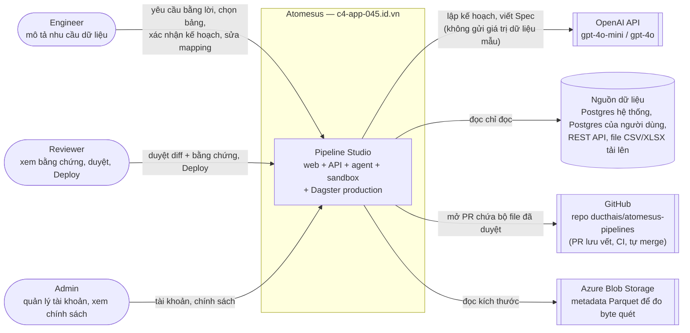
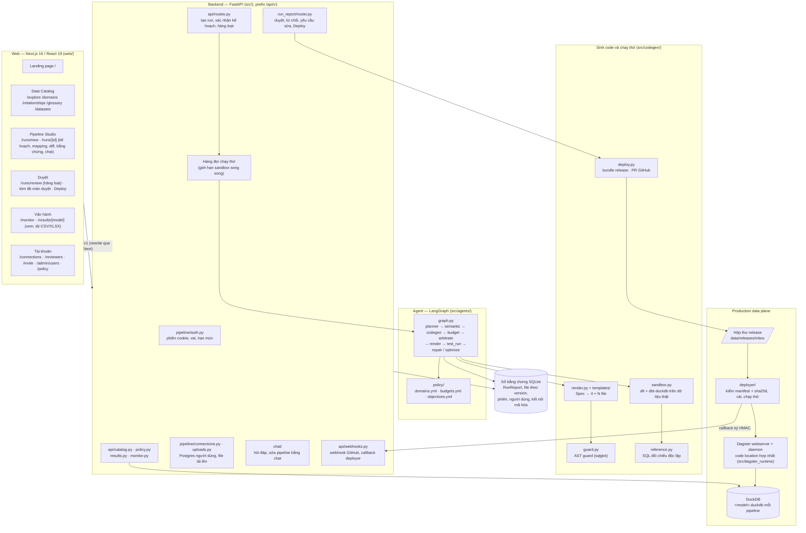
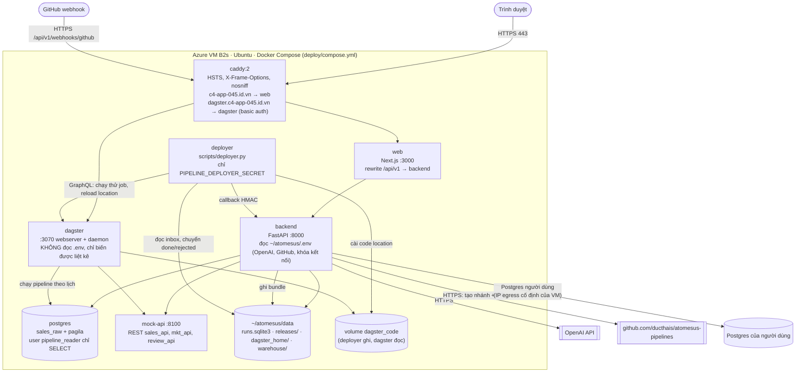
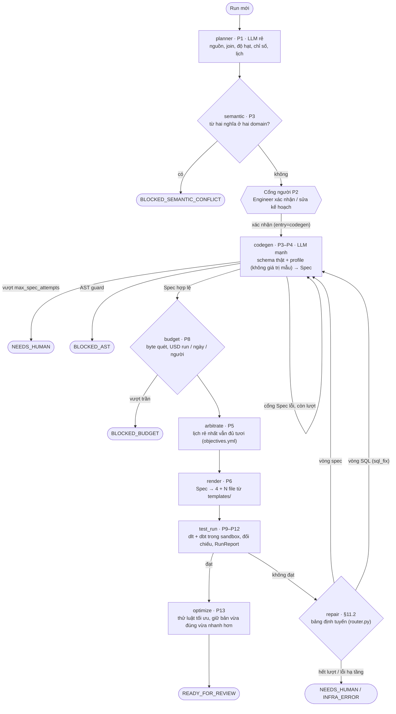
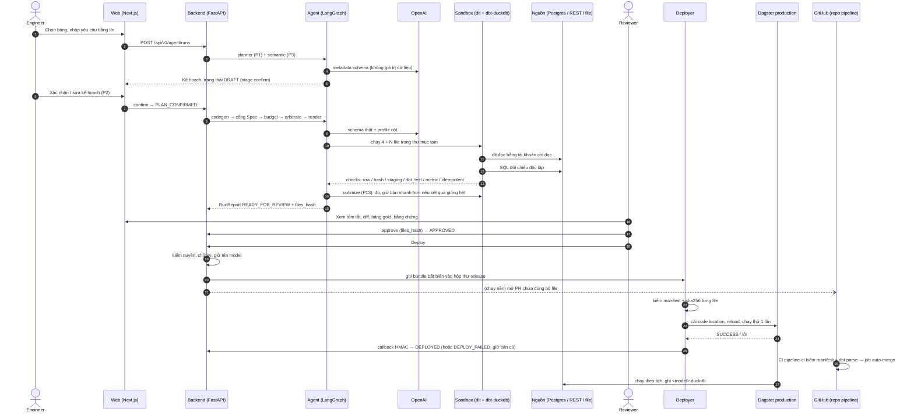
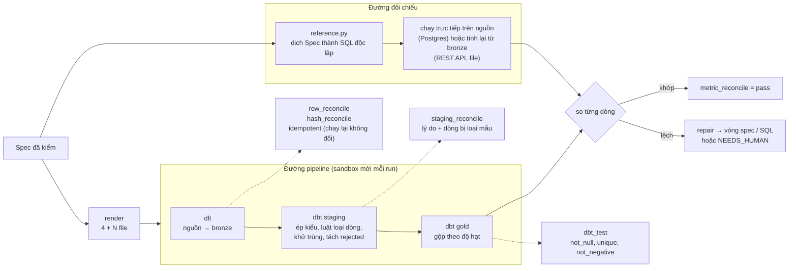
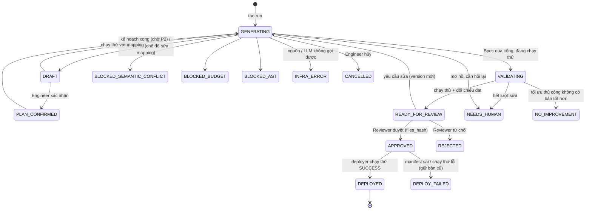
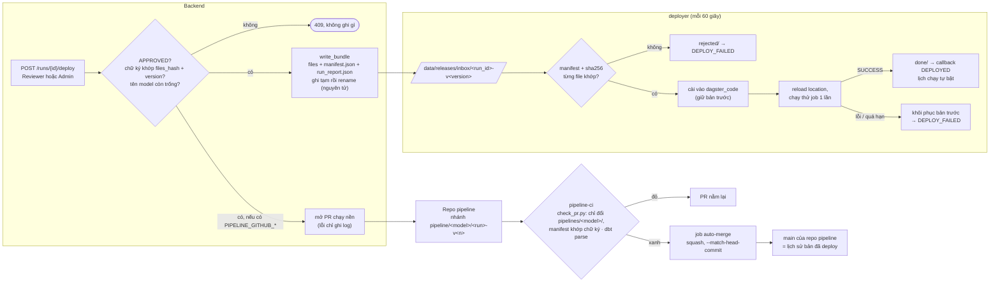
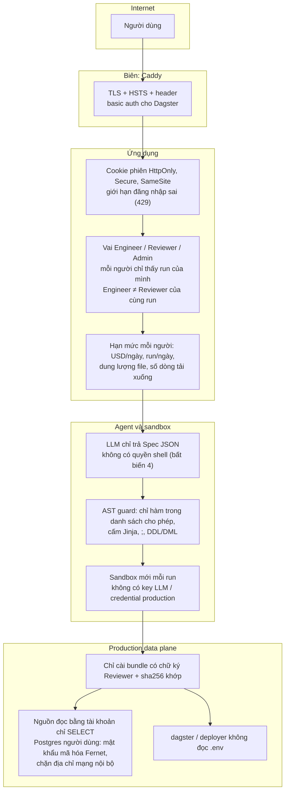

# Sơ đồ kiến trúc — Atomesus (P-045)

> Cập nhật 2026-10-18 theo code trên `main` (bản production `1072104`, https://c4-app-045.id.vn).
> Sơ đồ viết bằng Mermaid, GitHub hiển thị trực tiếp. Mô tả chữ từng thành phần ở [ARCHITECTURE.md](../ARCHITECTURE.md);
> quyết định thiết kế ở [ADR-0001](adr/0001-mot-luong-va-nen-production.md); đặc tả gốc ở [SPEC.md](../SPEC.md).

Mục lục

1. [Ngữ cảnh hệ thống](#1-ngữ-cảnh-hệ-thống)
2. [Các thành phần bên trong](#2-các-thành-phần-bên-trong)
3. [Triển khai production](#3-triển-khai-production)
4. [Agent LangGraph](#4-agent-langgraph)
5. [Luồng end-to-end: yêu cầu → production](#5-luồng-end-to-end-yêu-cầu--production)
6. [Sandbox và đối chiếu độc lập](#6-sandbox-và-đối-chiếu-độc-lập)
7. [Máy trạng thái của run](#7-máy-trạng-thái-của-run)
8. [Deploy: hộp thư release, deployer và GitOps](#8-deploy-hộp-thư-release-deployer-và-gitops)
9. [Ranh giới bảo mật](#9-ranh-giới-bảo-mật)
10. [Bảng tra module](#10-bảng-tra-module)

---

## 1. Ngữ cảnh hệ thống

Ai dùng hệ thống, hệ thống nói chuyện với bên ngoài nào.

Nguyên tắc xuyên suốt: **LLM chỉ viết Spec (JSON có kiểu), không viết code**. Code pipeline sinh tất định từ template;
chạy thử trên dữ liệu thật trong sandbox; người (Reviewer khác Engineer) duyệt bộ file có hash trước khi lên production.

---

## 2. Các thành phần bên trong

---

## 3. Triển khai production

Một VM **Azure B2s** (2 vCPU, 4 GB RAM) chạy toàn bộ bằng `deploy/compose.yml`. Tên miền ở Tenten, HTTPS do Caddy tự
cấp (Let's Encrypt). Deploy bằng `scripts/harness.py deploy --yes`: chỉ commit đã có gate xanh trên `origin/main`, sau
đó smoke test, đỏ thì quay về bản trước.

| Service | Ảnh | Vai trò | Bí mật được thấy |
|---|---|---|---|
| `caddy` | `caddy:2` | TLS, header bảo mật, basic auth cho Dagster | hash mật khẩu Dagster |
| `web` | `atomesus-web` | Next.js, render server, rewrite `/api/v1` | không |
| `backend` | `atomesus-app` | API, agent, sandbox, sổ bằng chứng | toàn bộ `.env` (OpenAI, GitHub, khóa Fernet kết nối) |
| `dagster` | `atomesus-app` | chạy pipeline đã deploy theo lịch | chỉ URL Postgres `pipeline_reader` và biến liệt kê |
| `deployer` | `atomesus-deployer` | cài bundle đã duyệt vào Dagster | chỉ secret ký callback |
| `postgres` | `atomesus-postgres` | nguồn mẫu `sales_raw`, `pagila` | mật khẩu admin (không lộ ra service khác) |
| `mock-api` | `atomesus-app` | nguồn REST mẫu | không |

---

## 4. Agent LangGraph

`src/agents/graph.py`. Node LLM chỉ có `planner` (model rẻ) và `codegen` (model mạnh); các node còn lại tất định. Mọi
node chạy dưới trần thời gian `budgets.yml: per_run.phase_timeout_sec`.

**Các cổng kiểm Spec** (`GateName` trong `src/run_report/models.py`): `spec_schema`, `schema_real`, `currency`,
`join_fanout`, `time_grain`, `filter_values`, `semantic`, `ast_guard`, `budget`, `arbitrate`, `post_run`.

**Trần mỗi run** (`policy/budgets.yml`): 6 lần gọi LLM, 2 vòng sửa Spec, 2 vòng sửa SQL, 0,05 USD, 5 GB quét; mỗi ngày
2 USD toàn hệ thống; mỗi người 0,30 USD và 20 run/ngày.

**UC-3 Tối ưu thủ công** (`src/agents/manual_optimize.py`): chạy lại optimizer trên pipeline có sẵn, `llm_calls = 0`;
không có bản tốt hơn thì kết thúc `NO_IMPROVEMENT`.

---

## 5. Luồng end-to-end: yêu cầu → production

---

## 6. Sandbox và đối chiếu độc lập

Bằng chứng trước khi duyệt không dựa vào chính pipeline: kết quả gold được tính lại bằng một đường khác.

Sandbox là thư mục tạm + `warehouse.duckdb` riêng mỗi run, xóa khi xong; tiến trình dlt/dbt không nhận API key LLM hay
credential production (bất biến 1 và 2, `tests/test_invariants.py`).

---

## 7. Máy trạng thái của run

`RunStatus` trong `src/run_report/models.py`.

Engineer tạo run không được tự duyệt run đó (bất biến 3, ADR-0001 §3). Duyệt chỉ ghi chữ ký gắn với `files_hash` và
`version`; đổi file nào là chữ ký mất hiệu lực.

---

## 8. Deploy: hộp thư release, deployer và GitOps

Chế độ mặc định `PIPELINE_DEPLOY_MODE=direct` (ADR-0001 D6).

Chế độ `pr` (tùy chọn) bỏ hộp thư: deployer kéo `main` của repo pipeline bằng deploy key chỉ đọc và chỉ cài sau khi PR
được merge.

---

## 9. Ranh giới bảo mật

---

## 10. Bảng tra module

| Thư mục | Nội dung chính |
|---|---|
| `src/agents/` | Graph LangGraph, node (`nodes/`), prompt, router sửa lỗi, optimizer P13, tối ưu thủ công, ngân sách, semantic |
| `src/spec/` | Hợp đồng Spec (Pydantic + JSON Schema), các cổng kiểm |
| `src/codegen/` | Render template, AST guard, sandbox, SQL đối chiếu, bundle release, client GitHub |
| `src/run_report/` | Hợp đồng `RunReport`, sổ bằng chứng SQLite, quyền xem, duyệt / từ chối / Deploy |
| `src/pipeline/` | Phiên đăng nhập, người dùng, kết nối Postgres người dùng, file tải lên, nguồn REST |
| `src/api/` | Router catalog, chính sách, kết quả, theo dõi, webhook GitHub / callback deployer |
| `src/deployer/` | Service deployer: hộp thư release, kiểm manifest, cài + chạy thử + rollback |
| `src/dagster_runtime/` | Code location hợp nhất nạp mọi pipeline đã cài, cấp credential theo nguồn |
| `src/monitor/` | Số đo mỗi lần chạy theo lịch, cảnh báo Day 2 (chậm, nguồn ngừng cấp) |
| `src/chat/` | Chat trên run: hỏi đáp, sửa pipeline bằng lời |
| `src/policy/` | Đọc `policy/*.yml`, chính sách hiệu lực theo người dùng |
| `templates/` | Jinja (`[[ ]]`) sinh dlt, dbt staging/gold, test, asset Dagster |
| `web/` | Next.js: catalog, studio, duyệt, theo dõi, tài khoản |
| `deploy/` | `compose.yml`, Caddyfile, script dựng VM, bản mẫu repo pipeline |
| `eval/` | Bộ chấm 20 ca, golden, dữ liệu bench 3 triệu dòng |
