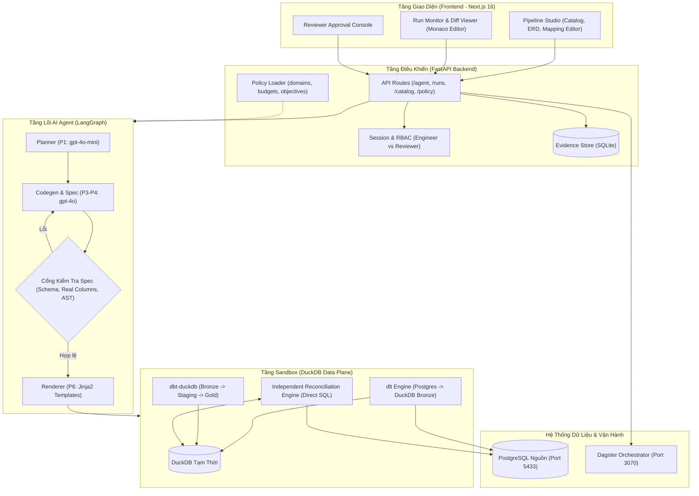
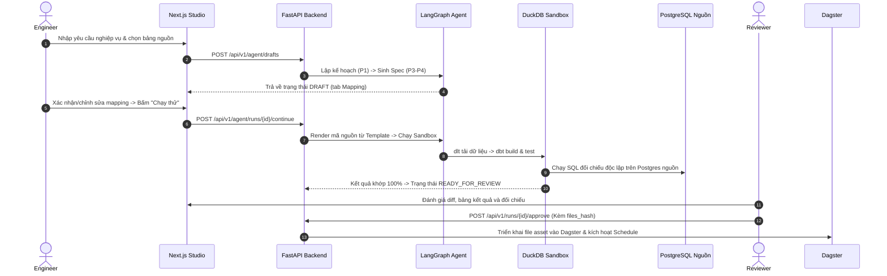
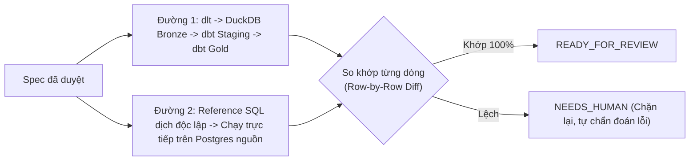

# Architecture Diagram — Atomesus (P-045)

> Tài liệu tổng hợp kiến trúc và sơ đồ hệ thống của dự án **Atomesus (P-045)**.
> Chi tiết toàn diện xem tại: [system_architecture_analysis.md](system_architecture_analysis.md)

---

## 1. High-Level Architecture

---

## 2. End-to-End Execution Flow

---

## 3. Independent Reconciliation (`metric_reconcile`)

