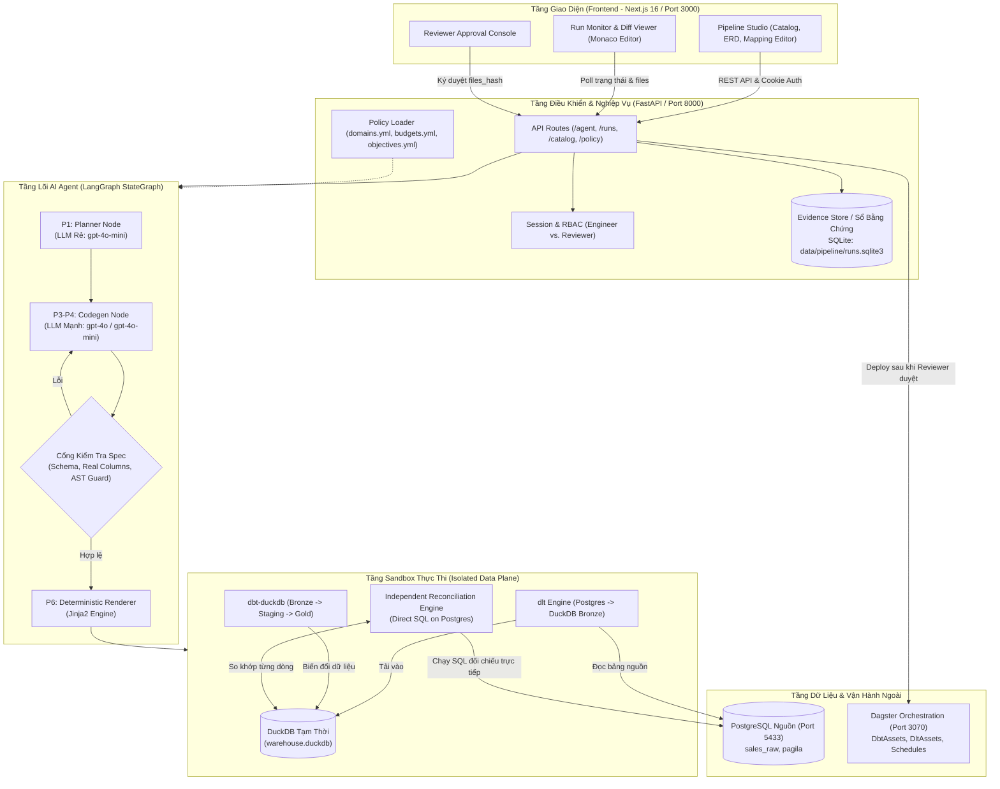
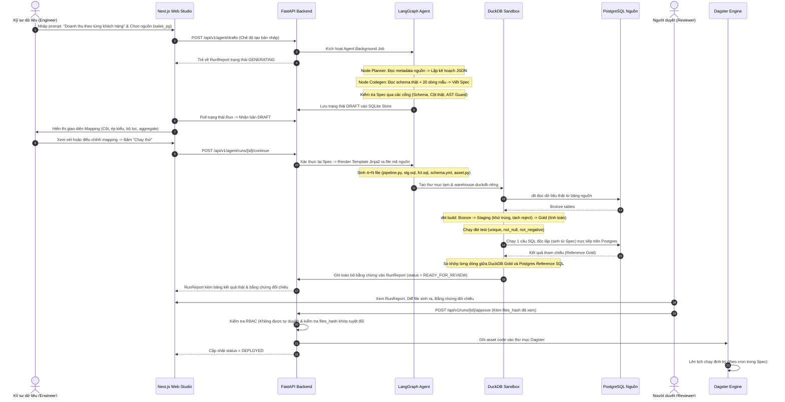
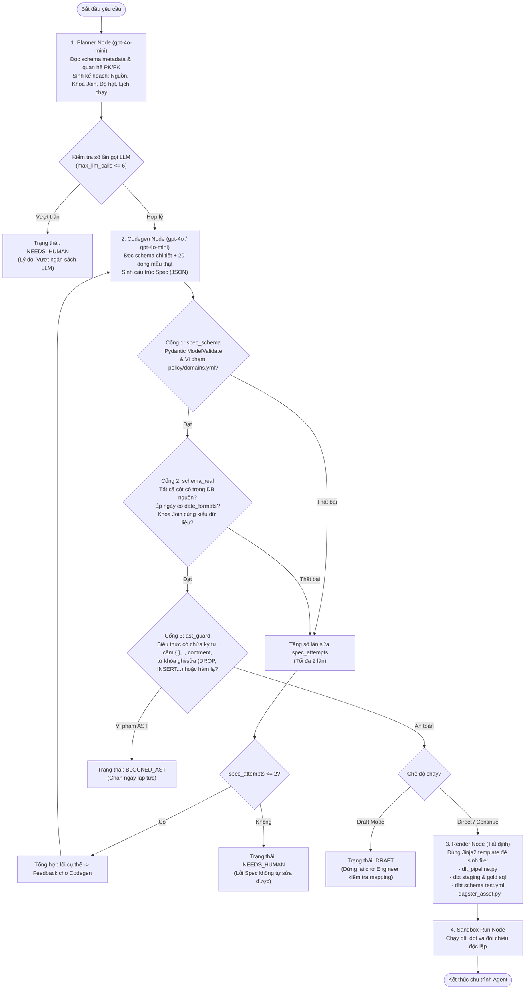
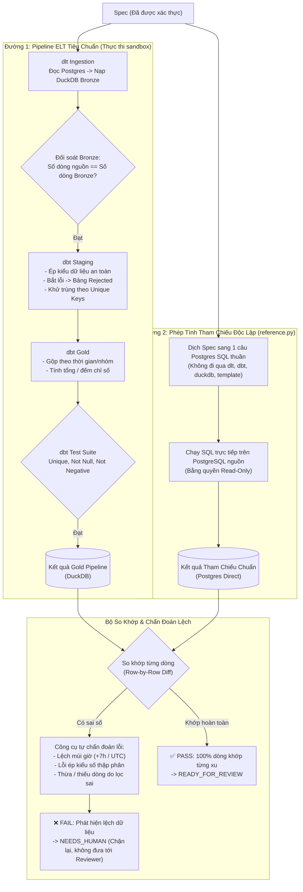
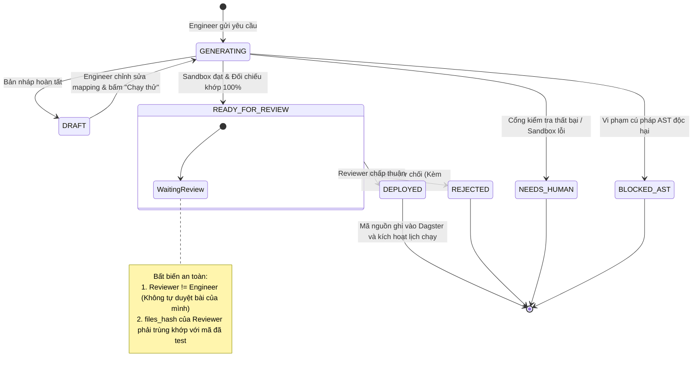

# Phân Tích Luồng Hoạt Động & Sơ Đồ Hệ Thống Atomesus (P-045)

> **Tài liệu phân tích kiến trúc hệ sinh thái ELT Agent — Dự án VinUni AI20K (Đội P-045)**  
> *Phiên bản: 1.0 — Cập nhật: 2026-10-03*

---

## 1. Giới thiệu tổng quan

**Atomesus** là nền tảng AI-Native ELT Pipeline Platform giải quyết bài toán tự động hoá xây dựng đường ống dữ liệu (Data Pipeline) từ yêu cầu nghiệp vụ bằng ngôn ngữ tự nhiên. 

Khác biệt với các công cụ "AI sinh SQL tự do", Atomesus hoạt động theo các nguyên tắc kỹ thuật cốt lõi:
1. **Agent ràng buộc (Constrained AI Agent)**: LLM chỉ chịu trách nhiệm phân tích schema, lập kế hoạch và sinh đặc tả kỹ thuật (Spec JSON). Mã nguồn thực thi (dlt, dbt, Dagster) được sinh hoàn toàn tất định qua Jinja2 template.
2. **Sandbox cô lập (Isolated Execution Sandbox)**: Mọi pipeline sinh ra được nạp dữ liệu thật và chạy thử ngay trong container/sandbox DuckDB riêng biệt, có cơ chế dọn dẹp tài nguyên tự động.
3. **Đối chiếu độc lập (Independent Reconciliation - `metric_reconcile`)**: Kết quả của pipeline (đường `dlt -> DuckDB -> dbt`) được so khớp từng dòng với một câu SQL Postgres thuần được dịch độc lập và chạy trực tiếp trên nguồn dữ liệu gốc. Mọi sai lệch (múi giờ, làm tròn, ép kiểu, mất dòng) đều bị phát hiện trước khi đến tay người duyệt.
4. **Phân quyền và ký duyệt bảo mật (Human-in-the-Loop & Cryptographic Review)**: Kỹ sư (Engineer) tạo và chỉnh sửa mapping; Người duyệt (Reviewer) xem xét diff mã nguồn, bảng kết quả và bằng chứng đối chiếu. Quyết định duyệt gắn liền với mã băm mật mã `files_hash` của phiên bản được xem.

---

## 2. Sơ đồ 1: Tổng quan kiến trúc hệ thống (High-Level Architecture)

Hệ thống được tổ chức thành 4 phân tầng ranh giới rõ ràng:

---

## 3. Sơ đồ 2: Luồng xử lý End-to-End từ Yêu cầu đến Triển khai

Quy trình tuần tự từ lúc tiếp nhận yêu cầu kinh doanh bằng ngôn ngữ tự nhiên đến khi triển khai lịch chạy định kỳ:

---

## 4. Sơ đồ 3: Chi tiết LangGraph AI Agent & Cơ chế phòng vệ nhiều lớp (Guardrails)

Agent được xây dựng bằng StateGraph (LangGraph) với cơ chế lặp phản hồi có kiểm soát ngân sách:

---

## 5. Sơ đồ 4: Luồng Sandbox & Đối chiếu độc lập (Independent Reconciliation)

Kiến trúc kiểm chứng kết quả bằng 2 đường tính toán độc lập nhằm loại trừ mọi rủi ro về sai lệch thực thi (execution drifts):

---

## 6. Sơ đồ 5: Phân quyền & Vòng đời trạng thái Run (State Machine & RBAC)

Toàn bộ các trạng thái mà một `RunReport` có thể trải qua trong hệ thống:

---

## 7. Bảng tra cứu module mã nguồn (Source Code Mapping)

| Thành phần | Đường dẫn tệp | Trách nhiệm kỹ thuật |
|---|---|---|
| **FastAPI Entrypoint** | [`src/main.py`](file:///home/cuong/P-045/src/main.py) | Khởi tạo ứng dụng, cấu hình CORS, tích hợp các sub-routers, xử lý lifespan và đánh dấu lỗi các run dở dang khi restart. |
| **Agent StateGraph** | [`src/agents/graph.py`](file:///home/cuong/P-045/src/agents/graph.py) | Cấu trúc LangGraph 4 node (`planner` $\rightarrow$ `codegen` $\rightarrow$ `render` $\rightarrow$ `test_run`) và các rẽ nhánh điều kiện. |
| **Agent Service** | [`src/agents/service.py`](file:///home/cuong/P-045/src/agents/service.py) | Điều phối chạy nền (background task), ghi nhận tiến độ timeline, cập nhật trạng thái `RunReport` vào SQLite. |
| **Spec Validator** | [`src/agents/validate.py`](file:///home/cuong/P-045/src/agents/validate.py) | Kiểm tra tính hợp lệ của Spec: Pydantic schema, đối chiếu cột thực tế, bảo vệ cú pháp AST. |
| **Template Renderer** | [`src/codegen/render.py`](file:///home/cuong/P-045/src/codegen/render.py) | Đọc `Spec` và nạp Jinja2 templates tại `templates/` để sinh mã nguồn dlt, dbt và Dagster. |
| **Sandbox Runner** | [`src/codegen/sandbox.py`](file:///home/cuong/P-045/src/codegen/sandbox.py) | Khởi tạo môi trường thư mục tạm + DuckDB, thực thi `subprocess` dlt và dbt với biến môi trường tối thiểu (không leak LLM key). |
| **Independent Checker** | [`src/codegen/reference.py`](file:///home/cuong/P-045/src/codegen/reference.py) | Dịch Spec thành 1 câu SQL PostgreSQL độc lập, chạy trên nguồn và so khớp từng dòng với kết quả Gold của DuckDB. |
| **Evidence Store** | [`src/run_report/store.py`](file:///home/cuong/P-045/src/run_report/store.py) | Lưu trữ phiên bản, báo cáo chạy `RunReport`, nội dung tệp mã nguồn và tính toán `files_hash`. |
| **Deployer** | [`src/codegen/deploy.py`](file:///home/cuong/P-045/src/codegen/deploy.py) | Ghi mã nguồn đã được Reviewer duyệt vào thư mục code location của Dagster để nạp lịch chạy chính thức. |
| **Frontend Studio** | [`web/`](file:///home/cuong/P-045/web/) | Next.js 16 UI: Catalog dữ liệu, sơ đồ ER quan hệ bảng, giao diện xem & chỉnh sửa Mapping, so sánh phiên bản (Diff), phòng duyệt của Reviewer. |
