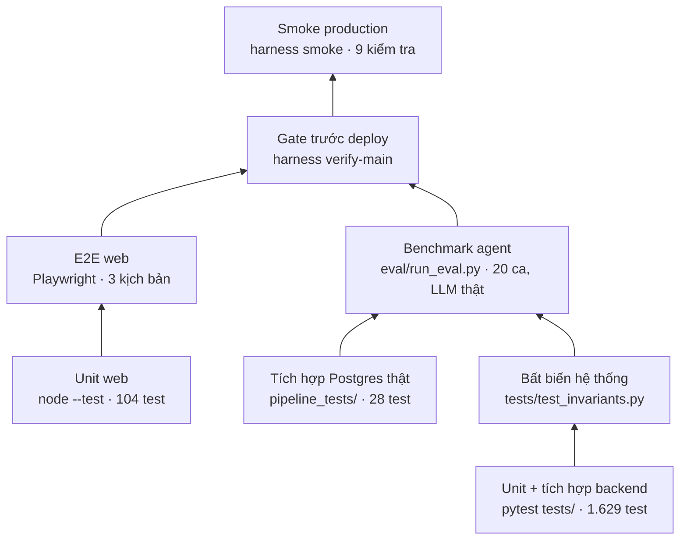

# Tài liệu kiểm thử — Atomesus (P-045)

> Cập nhật 2026-10-18. Mô tả chiến lược kiểm thử, các bộ test, cách chạy, kết quả lần chạy gần nhất và benchmark agent.
> Kết quả benchmark chi tiết từng ca: [eval/results/latest.md](../eval/results/latest.md) (số liệu thô `latest.json`).

Mục lục

1. [Mục tiêu và nguyên tắc](#1-mục-tiêu-và-nguyên-tắc)
2. [Các tầng kiểm thử](#2-các-tầng-kiểm-thử)
3. [Bộ test backend theo module](#3-bộ-test-backend-theo-module)
4. [Tám bất biến hệ thống](#4-tám-bất-biến-hệ-thống)
5. [Test giao diện](#5-test-giao-diện)
6. [Benchmark agent (eval 20 ca)](#6-benchmark-agent-eval-20-ca)
7. [Gate trước khi lên production và smoke test](#7-gate-trước-khi-lên-production-và-smoke-test)
8. [Cách chạy](#8-cách-chạy)
9. [Kết quả lần chạy gần nhất](#9-kết-quả-lần-chạy-gần-nhất)
10. [Giới hạn đã biết](#10-giới-hạn-đã-biết)

---

## 1. Mục tiêu và nguyên tắc

| Câu hỏi cần trả lời | Bằng chứng |
|---|---|
| Code đúng hợp đồng (Spec, RunReport, API)? | pytest backend, test web |
| Pipeline sinh ra chạy được và ra số đúng trên dữ liệu thật? | test dbt thật trên DuckDB, đối chiếu độc lập, eval so golden từng dòng |
| Agent chặn đúng yêu cầu nguy hiểm / vượt ngân sách / mơ hồ? | eval nhóm vi phạm và mơ hồ, test các cổng |
| Không thể lên production nếu chưa có người duyệt đúng bộ file? | 8 bất biến, test deploy / deployer / manifest |
| Optimizer cải thiện thật mà không đổi kết quả? | eval optimizer có ca 3 triệu dòng, đo trước / sau |
| Bản production đang chạy được? | gate trước deploy, smoke test sau deploy |

Nguyên tắc:

- **Không mock phần cần chứng minh.** dbt, DuckDB, sqlglot, dlt chạy thật trong test; chỉ thay ở biên ngoài (LLM giả
  `FakeLLM`, GitHub giả `FakeGithub` bằng `httpx.MockTransport`, nguồn REST giả).
- **Tất định.** Test không gọi mạng, không cần API key; LLM chỉ có trong benchmark (`eval/`), tách khỏi `pytest`.
- **Mẫu số luôn đi kèm** khi báo kết quả (SPEC §18.3): "6/7", không chỉ "đạt".

---

## 2. Các tầng kiểm thử



| Tầng | Lệnh | Cần gì | Thời gian |
|---|---|---|---|
| Backend unit + tích hợp | `python -m pytest tests -q` | Python 3.11, `requirements.txt` + `requirements/dagster.txt` | ~11 phút |
| Lint / format | `ruff check src tests && ruff format --check src tests` | — | vài giây |
| Web unit | `cd web && npm run typecheck && npm test` | Node 24 | vài giây |
| Web build | `cd web && npm run build` | Node 24 | ~10 giây |
| Web E2E | `cd web && npm run test:e2e` | Playwright + Chromium | ~1 phút |
| Tích hợp Postgres | `python -m pytest pipeline_tests` | Postgres nguồn đang chạy | ~1 phút |
| Benchmark agent | `python eval/run_eval.py` (hoặc `make eval`) | Postgres nguồn, mock API, `OPENAI_API_KEY` | ~35 phút |
| Gate đầy đủ | `python scripts/harness.py verify-main` | Docker Desktop | ~10 phút |
| Smoke production | `python scripts/harness.py smoke` | mạng | vài giây |

---

## 3. Bộ test backend theo module

Số test đếm theo hàm `test_*` (một hàm có thể tham số hóa thành nhiều ca khi chạy).

| Thư mục | File | Hàm test | Kiểm gì |
|---|---|---|---|
| `tests/test_agents/` | 25 | 229 | graph LangGraph, planner (domain, khái niệm, câu hỏi làm rõ), codegen + vòng sửa, semantic, budget (run / ngày / người), arbitrate, router sửa lỗi, optimizer P13, tối ưu thủ công, hàng loạt, hủy, timeout |
| `tests/test_api/` | 17 | 218 | API run, phân quyền theo chủ, mời Reviewer, hạn mức, đăng ký / đăng nhập / giới hạn sai mật khẩu, kết nối Postgres người dùng, upload, chính sách theo vai, webhook, catalog, kết quả + tải CSV/XLSX |
| `tests/test_deployer/` | 7 | 122 | manifest + sha256, hộp thư release, cài nguyên tử + rollback, chạy thử sau cài, callback HMAC, repo pipeline (CI, workflow mẫu) |
| `tests/test_codegen/` | 14 | 87 | render template, AST guard, sandbox dlt + dbt thật, SQL đối chiếu độc lập, nguồn REST / file, mở PR (GitHub giả) |
| `tests/test_run_report/` | 5 | 67 | hợp đồng RunReport, sổ bằng chứng, duyệt / từ chối / yêu cầu sửa / Deploy, chữ ký gắn `files_hash` |
| `tests/test_spec/` | 3 | 28 | hợp đồng Spec + JSON Schema, các cổng kiểm |
| `tests/test_eval/` | 4 | 28 | hàm chấm của benchmark (so golden, chấm optimizer), sinh dữ liệu bench |
| `tests/test_dagster_runtime/` | 7 | 25 | code location hợp nhất, credential theo nguồn, file DuckDB riêng mỗi pipeline |
| `tests/test_monitor/` | 5 | 25 | số đo mỗi lần chạy theo lịch, cảnh báo Day 2 |
| `tests/test_policy/` | 3 | 25 | đọc `policy/*.yml`, chính sách hiệu lực theo người dùng |
| `tests/test_chat/` | 4 | 19 | hỏi đáp trên run, sửa pipeline bằng chat, trần câu hỏi |
| `tests/test_orchestration/` | 2 | 6 | trạng thái Dagster qua GraphQL |
| `tests/` (gốc) | 4 | 40 | bất biến hệ thống, gia cố production (môi trường Dagster không có key LLM…), SQLite (WAL, đồng thời), import |
| `pipeline_tests/` | 3 | 20 (28 ca khi chạy) | staging DuckDB thật + hợp đồng API, đọc Postgres nguồn bằng tài khoản chỉ đọc (cần `PIPELINE_TEST_DATABASE_URL`) |

---

## 4. Tám bất biến hệ thống

SPEC §19, chỉnh theo [ADR-0001 §3](adr/0001-mot-luong-va-nen-production.md) cho chế độ deploy thẳng. Mỗi bất biến là
test trong `tests/test_invariants.py` (cùng các test liên quan ở module khác).

| # | Bất biến | Test chính |
|---|---|---|
| 1 | Sandbox mới cho mỗi run, xóa sau khi xong | `test_1_*` |
| 2 | Không có credential production trong môi trường agent / sandbox | `test_2_*`, `tests/test_production_hardening.py` |
| 3 | Mọi file deploy truy vết được về một `run_id` và một chữ ký duyệt; Engineer không tự duyệt | `test_3_nobody_approves_their_own_run`, `test_3_and_6_only_the_signed_files_are_deployed` |
| 4 | Không node LLM nào chạy lệnh shell | `test_4_*` |
| 5 | Mọi phiên bản Spec đều nằm trong `spec_history` | `test_5_every_spec_version_is_kept` |
| 6 | Chữ ký duyệt phải khớp `files_hash` mới deploy được | `test_3_and_6_*`, test deploy ở `tests/test_run_report/` |
| 7 | `llm_calls ≤ budgets.per_run.max_llm_calls`, không hardcode con số | `test_7_llm_calls_never_exceed_the_policy_limit`, `test_7_limit_is_not_hardcoded` |
| 8 | App không có quyền merge; client GitHub chỉ có thao tác tối thiểu | `test_8_system_has_no_way_to_merge`, `test_8_github_client_only_has_minimal_operations` |

Bất biến 8 được giữ cả khi bật tự merge: việc merge do GitHub Actions của repo pipeline làm sau khi CI kiểm chữ ký
(job `auto-merge`, bản mẫu `deploy/pipeline-repo/.github/workflows/ci.yml`, test ở `tests/test_deployer/test_pipeline_repo.py`).

---

## 5. Test giao diện

| Bộ | File | Kiểm gì |
|---|---|---|
| Unit (`node --test`, 104 test) | `web/tests/*.test.ts` | dựng catalog từ RunReport, bước Deploy (direct / pr), lời mời, hạn mức, kết quả + tải xuống, tóm tắt màn duyệt, kết nối và upload, gọi API Postgres |
| E2E (Playwright) | `web/tests/e2e/pipeline-lifecycle.spec.ts` | đăng nhập → tạo mẻ pipeline → phê duyệt → Deploy (backend giả `fixture-backend.mjs`) |
| E2E (Playwright) | `web/tests/e2e/run-summary.spec.ts` | màn duyệt ở nhiều độ rộng màn hình: tóm tắt nằm trước tab và nút duyệt; thiếu dữ liệu chỉ hiện câu có căn cứ |
| Ảnh chụp UI (gate) | `scripts/harness.py` | chụp desktop + mobile mọi trang ở chế độ `CATALOG_MOCK=1`, so với baseline, lưu ở `.harness/gates/<nhánh>/ui/<sha>/` |

---

## 6. Benchmark agent (eval 20 ca)

`eval/run_eval.py` chạy **agent thật** (OpenAI) trên **nguồn thật** (Postgres `sales_raw`, `pagila`, mock REST API, thư
mục CSV, bộ sự kiện 3 triệu dòng). Mỗi ca: lập kế hoạch → tự xác nhận (P2) → viết Spec → chạy thử trong sandbox → so
kết quả. Run ghi vào sổ bằng chứng riêng (`data/eval/runs.sqlite3`).

| Nhóm | Số ca | Đạt khi |
|---|---|---|
| Hợp lệ | 7 | tới `READY_FOR_REVIEW` và bảng gold khớp golden **từng dòng** (sai số ≤ 0,01%) |
| Vi phạm | 6 | dừng đúng mã: `BLOCKED_AST` (2), `BLOCKED_BUDGET` (2), `BLOCKED_SEMANTIC_CONFLICT` (2) |
| Mơ hồ | 3 | dừng `NEEDS_HUMAN` ở bước `plan` kèm câu hỏi làm rõ, không đoán |
| Optimizer | 4 | P13 và UC-3 đúng hành vi: đo khi luật áp, bỏ qua kèm lý do khi không; UC-3 `llm_calls = 0`; chỉ giữ bản vừa đúng vừa nhanh hơn |

Danh sách ca:

| Ca | Nhóm | Yêu cầu | Nguồn | Mong đợi |
|---|---|---|---|---|
| `valid_postgres_daily_revenue` | hợp lệ | Doanh thu theo ngày | `sales_pg` | khớp golden |
| `valid_filesystem_refunds_by_order` | hợp lệ | Tổng tiền hoàn và số khoản hoàn của từng đơn | `landing_sales` (CSV) | khớp golden |
| `valid_rest_api_paid_by_order` | hợp lệ | Tổng đã thanh toán và số lần thanh toán từng đơn | `sales_api` (REST) | khớp golden |
| `valid_postgres_filesystem_by_customer` | hợp lệ | Theo khách: tổng tiền đơn và tổng đã hoàn | `sales_pg` + CSV | khớp golden |
| `valid_postgres_rest_api_by_customer` | hợp lệ | Theo khách: số đơn, tổng tiền đơn, tổng đã trả | `sales_pg` + REST | khớp golden |
| `valid_three_sources_by_customer` | hợp lệ | Theo khách: tổng đơn, đã trả, đã hoàn | 3 nguồn | khớp golden |
| `valid_postgres_rest_api_reviews_by_customer` | hợp lệ | Theo khách: số lượt thuê, số phản hồi, điểm trung bình | `pagila_pg` + `review_api` | khớp golden |
| `violation_ast_forbidden_function` | vi phạm | lọc bằng biểu thức chính quy | `sales_pg` | `BLOCKED_AST` |
| `violation_ast_jinja_injection` | vi phạm | chèn cú pháp Jinja vào biểu thức | `sales_pg` | `BLOCKED_AST` |
| `violation_budget_daily_spend` | vi phạm | hôm nay đã tiêu hết trần ngày | `sales_pg` | `BLOCKED_BUDGET` |
| `violation_budget_scan_limit` | vi phạm | vượt trần byte quét mỗi run | `sales_pg` | `BLOCKED_BUDGET` |
| `violation_semantic_new_customers` | vi phạm | "khách hàng mới" — `customer` có nghĩa khác nhau giữa domain | tất cả | `BLOCKED_SEMANTIC_CONFLICT` |
| `violation_semantic_revenue_per_customer` | vi phạm | "tiền mỗi khách đã chi" — như trên | tất cả | `BLOCKED_SEMANTIC_CONFLICT` |
| `ambiguous_profit_margin` | mơ hồ | Biên lợi nhuận theo ngày (không có cột chi phí) | `sales_pg` | `NEEDS_HUMAN` |
| `ambiguous_revenue_target` | mơ hồ | So doanh thu với chỉ tiêu (không có bảng chỉ tiêu) | `sales_pg` | `NEEDS_HUMAN` |
| `ambiguous_sales_report` | mơ hồ | "Làm cho tôi một báo cáo về bán hàng" | tất cả | `NEEDS_HUMAN` |
| `optimize_incremental_tried_on_real_dbt` | optimizer | Doanh thu theo ngày | `sales_pg` | thử incremental trên dbt thật, bỏ nếu không nhanh hơn |
| `optimize_large_events_by_day` | optimizer | Sự kiện, người dùng, tiền theo ngày | `landing_bench` (3 triệu dòng) | giữ bản tối ưu, gold giống hệt |
| `optimize_pagila_rentals_by_day` | optimizer | Số lượt thuê DVD theo ngày | `pagila_pg` | đo và quyết định đúng số đo |
| `optimize_small_table_skipped` | optimizer | Doanh thu theo ngày (30 dòng) | `sales_pg` | UC-3 không thử, `NO_IMPROVEMENT` kèm lý do |

Kết quả lượt chạy gần nhất: xem [mục 9](#9-kết-quả-lần-chạy-gần-nhất).

**Đo thời gian người vs máy** (ngoài benchmark tự động): quy trình bấm giờ ở [time-study.md](time-study.md); phía agent
tự ghi trong khung "Thời gian & công sức" của từng run.

---

## 7. Gate trước khi lên production và smoke test

`scripts/harness.py verify-main` chạy trên đúng commit của `origin/main` và ghi bản ghi gate theo SHA:

| Bước | Nội dung |
|---|---|
| secrets + hygiene | không có khóa / mật khẩu thật trong diff, không file rác |
| ruff check | lint backend |
| pytest (docker) | toàn bộ `tests/` trong image Linux giống production |
| npm ci, web typecheck, web test, web build | frontend |
| ui | chụp ảnh mọi trang (desktop + mobile) ở chế độ mock, so baseline |

`scripts/harness.py deploy --yes` chỉ deploy commit đã có gate xanh, rồi chạy smoke; smoke đỏ thì quay về bản trước.

Smoke production (`scripts/harness.py smoke`, chỉ GET):

| Kiểm tra | Mong đợi |
|---|---|
| Trang chủ | HTTP 200 |
| Header bảo mật | đủ HSTS, X-Frame-Options, nosniff, Referrer-Policy |
| Không lộ server | không có header `Server` / `X-Powered-By` |
| http → https | 308 |
| Backend agent | 200, `status=ready` |
| API cần đăng nhập | 401 khi chưa đăng nhập |
| Dagster có basic auth | 401 khi không có mật khẩu |
| Chứng chỉ 2 tên miền | còn hạn |

---

## 8. Cách chạy

```bash
# 0. Môi trường (một lần)
python -m venv .venv && .venv\Scripts\activate          # macOS/Linux: source .venv/bin/activate
pip install -r requirements.txt -r requirements/dagster.txt
cd web && npm ci && cd ..

# 1. Test backend (venv phải được activate để lệnh `dbt` có trong PATH)
python -m pytest tests -q
ruff check src tests && ruff format --check src tests

# 2. Test web
cd web && npm run typecheck && npm test && npm run build && cd ..
cd web && npx playwright install chromium && npm run test:e2e && cd ..

# 3. Tích hợp Postgres + benchmark: cần Postgres nguồn và mock API
docker compose --env-file .env -p p045-b -f infra/postgres/compose.yml up -d --build --wait
python scripts/seed_pipeline.py                 # volume cũ: nạp lại đúng seed hiện tại của repo (upsert, không xóa gì)
make mock-api                                   # terminal riêng (cổng 8100)
PIPELINE_TEST_DATABASE_URL=$PIPELINE_DATABASE_URL python -m pytest pipeline_tests   # không đặt thì 4 test bị bỏ qua
python eval/run_eval.py                         # hoặc: make eval; cần OPENAI_API_KEY trong .env
python eval/run_eval.py --group optimize        # chỉ nhóm optimizer (ghi latest_optimize.md)
python eval/run_eval.py --only valid_postgres_daily_revenue   # một ca (ghi latest_selected.md)

# 4. Gate + deploy + smoke (cần Docker Desktop)
python scripts/harness.py verify-main
python scripts/harness.py deploy --yes
python scripts/harness.py smoke
```

Lượt benchmark đầy đủ ghi `eval/results/latest.md` và `latest.json`; lượt lọc ghi file riêng để không đè lượt đầy đủ.

---

## 9. Kết quả lần chạy gần nhất

Ngày chạy: 2026-10-17 → 18, máy dev Windows 11 (venv Python 3.11 đồng bộ `requirements.txt`), Postgres nguồn nạp đúng
seed của repo.

| Bộ | Kết quả |
|---|---|
| Backend `pytest tests` | **1.629 passed, 2 skipped** (11 phút) |
| Độ phủ `src/` (`--cov=src`) | **93%** (9.277 câu lệnh, 637 câu chưa chạy tới) |
| Lint / format | `ruff check` sạch, `ruff format --check` sạch |
| Web unit | **104/104**; `tsc --noEmit` không lỗi; `next build` thành công |
| Web E2E (Playwright, Chrome) | **4/4** |
| Tích hợp Postgres (`pipeline_tests`, có `PIPELINE_TEST_DATABASE_URL`) | **28/28** |
| Gate `verify-main` trên bản production `ea7c2c1` | xanh: secrets, ruff, pytest (Docker), npm ci, typecheck, test, build, ui |
| Smoke production sau deploy `ea7c2c1` | 9/9 xanh |
| **Benchmark 20 ca** (lượt chính thức) | **19/20**: hợp lệ 6/7, vi phạm 6/6, mơ hồ 3/3, optimizer 4/4; $0,0235; 1.595 giây |

Benchmark qua 5 lượt trong đợt này (chi tiết và nguyên nhân từng thay đổi ở
[eval/results/report.md §2.2](../eval/results/report.md)):

| Lượt | Thay đổi | Tổng |
|---|---|---|
| 1 | code `main`, Postgres máy dev còn seed sạch cũ | bộ chấm dừng ở ca cuối |
| 2 | sửa bộ chấm | 15/20 |
| 3 | sửa planner: khái niệm "theo ngày" được grain cột ngày phủ | 19/20 |
| 4 | nạp lại seed bẩn hiện tại của repo → lộ hồi quy định dạng ngày | 13/20 |
| 5 | thêm định dạng `%Y/%m/%d` | **19/20** |

Ca optimizer 3 triệu dòng giữ bản tối ưu ở mọi lượt chấm xong: nhanh hơn 23,0–43,2% với bảng gold giống hệt bản gốc.

Đợt kiểm thử này tìm và sửa:

| Phát hiện | Loại | Sửa |
|---|---|---|
| Thiếu `%Y/%m/%d` trong `DATE_FORMATS`: pipeline trên nguồn có ngày `2026/01/05` bị tách dòng, dừng `NEEDS_HUMAN` | lỗi sản phẩm (hồi quy) | `src/agents/nodes/codegen.py` + test |
| Planner hỏi lại yêu cầu rõ khi cột ngày lưu dạng chuỗi | lỗi sản phẩm | `src/agents/nodes/planner.py` + 3 test |
| Bộ chấm dừng khi pipeline gốc của ca optimizer không tới bước duyệt | lỗi công cụ đo | `eval/run_eval.py` |
| E2E hỏng sau khi thêm nút "Hiện mật khẩu" | test cũ | `web/tests/e2e/*.spec.ts` |
| `pipeline_tests` cũ so với domain ẩn và luật mật khẩu production | test cũ | `pipeline_tests/test_pipeline.py` |
| Môi trường dev: venv thiếu bản `sqlglot` mới, `dbt` không trong PATH, Postgres seed cũ | môi trường | ghi ở mục 8 và 10 |

---

## 10. Giới hạn đã biết

- **LLM không tất định.** Agent gọi OpenAI với `temperature=0` (`src/agents/llm.py`), nhưng OpenAI không bảo đảm cùng
  đầu ra giữa các lần gọi, nên cùng một ca có thể đạt ở lượt này và không đạt ở lượt khác (planner hỏi lại một yêu cầu
  rõ, hoặc không sửa kịp Spec trong 2 vòng).
  Benchmark báo kết quả từng lượt kèm mẫu số; muốn đánh giá độ ổn định thì chạy nhiều lượt (mục 9 có số liệu lặp lại).
- **Ca optimizer 3 triệu dòng mất ~18 phút** trên máy dev (sinh dữ liệu lần đầu + đo nhiều mẫu); số giây phụ thuộc máy.
- **Dữ liệu mẫu nhỏ** (`sales_raw` 30 đơn): optimizer đúng khi **không** giữ bản tối ưu trên bảng nhỏ; ca 3 triệu dòng là
  ca chứng minh cải thiện thật.
- **Seed của Postgres máy dev phải là bản hiện tại.** Volume tạo trước 06/10 còn seed sạch (`sales_raw.orders` không có
  ngày ghi nhiều kiểu); benchmark trên seed đó cho kết quả đẹp hơn thật và giấu lỗi định dạng ngày (lượt 2–3 ở mục 9).
  Chạy `python scripts/seed_pipeline.py` trước khi đo.
- **Môi trường máy dev:** venv phải cài đúng `requirements.txt` (ví dụ `sqlglot>=30,<31`) và được activate (lệnh `dbt`
  trong PATH); nếu không, một số test dbt thật báo lỗi môi trường, không phải lỗi code. Gate chạy pytest trong Docker
  nên không bị ảnh hưởng.
- **E2E web dùng backend giả** (`fixture-backend.mjs`), không gọi LLM; luồng trọn vẹn với LLM thật được phủ bởi benchmark
  và chạy tay trên production.
